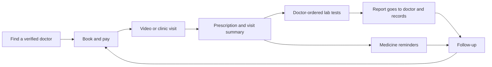

# MedEase: Software Requirements Specification

Version 1.0 · 2026-10-28 · Status: draft for review

This document lists everything MedEase needs to be a production healthcare product: what is built, what is designed, and what is new. It is the source for planning; [roadmap.md](./roadmap.md) holds the milestone currently being worked on, and the feature design docs ([prescriptions.md](./prescriptions.md), [chat.md](./chat.md)) hold the detailed designs. When a requirement here gets built, give it a design doc the same way and keep its ID in the commit or doc so it can be traced.

## Contents

1. [Introduction](#1-introduction)
2. [Overall description](#2-overall-description)
3. [Current state](#3-current-state-2026-10-28)
4. [Functional requirements](#4-functional-requirements)
5. [Non-functional requirements](#5-non-functional-requirements)
6. [Data requirements](#6-data-requirements)
7. [External interfaces](#7-external-interfaces)
8. [Release plan](#8-release-plan)
9. [Open decisions](#9-open-decisions)
10. [References](#10-references)

## Progress

Generated by `npm run srs -- --write` from the requirement tables below; don't edit by hand. "Done" counts Built and Verified. How to update statuses: [1.6](#16-tracking-progress).

<!-- progress:start -->

**29 of 343 requirements done (8%)**, 0 in progress, 19 partial.

| Phase                                      | Total | Done | In progress | Partial | Not started | Progress |
| ------------------------------------------ | ----- | ---- | ----------- | ------- | ----------- | -------- |
| Already built                              | 10    | 10   | 0           | 0       | 0           | 100%     |
| Phase 0: Launch readiness                  | 60    | 19   | 0           | 13      | 28          | 32%      |
| Phase 1: Close the care loop (Milestone 2) | 55    | 0    | 0           | 2       | 53          | 0%       |
| Phase 2: Trust and revenue                 | 91    | 0    | 0           | 4       | 87          | 0%       |
| Phase 3: Differentiators                   | 78    | 0    | 0           | 0       | 78          | 0%       |
| Phase 4: Scale                             | 50    | 0    | 0           | 0       | 50          | 0%       |

| Priority | Total | Done | In progress | Partial | Not started | Progress |
| -------- | ----- | ---- | ----------- | ------- | ----------- | -------- |
| P0       | 67    | 28   | 0           | 13      | 26          | 42%      |
| P1       | 147   | 1    | 0           | 6       | 140         | 1%       |
| P2       | 79    | 0    | 0           | 0       | 79          | 0%       |
| P3       | 50    | 0    | 0           | 0       | 50          | 0%       |

<!-- progress:end -->

---

## 1. Introduction

### 1.1 The problem

Healthcare in Pakistan is fragmented. Most records are on paper, and nothing carries a patient's history from one doctor, lab or pharmacy to the next. Existing apps are mostly directories: they help you find and book a doctor, but the care stops at the booking. Patients book again by hand for refills, carry lab reports back to the doctor themselves, and forget doses. Trust is low: people can't easily check a doctor's registration, and there is no national data protection law yet. Access is uneven: weak internet outside big cities, many patients more comfortable in Urdu than English, and many women who prefer a female doctor.

### 1.2 What MedEase is for

**MedEase closes the care loop.** One place where a patient finds a verified doctor, consults by video or in clinic, receives a prescription and lab orders, gets tests done at home, has the report go straight back to the same doctor, is reminded to take medicines, and books the follow-up, with the whole history kept for them and their family.

Every feature in this document should make one step of the loop work, or connect two steps. Features that do neither go to the end of the plan.

### 1.3 Scope

**In scope**: web app (mobile-first, installable as a PWA) for patients and their families, doctors, laboratories and platform staff; online consultations and in-clinic bookings; prescriptions; lab bookings and reports; health records; messaging; an AI symptom assistant; payments and payouts; notifications.

**Out of scope for now**: emergency care (MedEase always points to emergency services), hospital inpatient systems, our own pharmacy stock, native mobile apps (reconsidered in Phase 4), insurance claims processing.

### 1.4 Terms

| Term                | Meaning                                                                                                                                  |
| ------------------- | ---------------------------------------------------------------------------------------------------------------------------------------- |
| Account holder      | A signed-in person (patient, doctor, lab user, admin).                                                                                   |
| Care recipient      | The person receiving care. Usually the patient themself, or a family member they manage (child, elderly parent).                         |
| Encounter           | Any consultation the doctor is responsible for: video, audio, in-clinic or text. Prescriptions attach to one.                            |
| Care loop           | Visit → prescription/orders → tests → results → reminders → follow-up.                                                                   |
| PHI                 | Personal health information: anything that links a person to their health (names with visits, medicines, tests).                         |
| PMDC                | Pakistan Medical and Dental Council; every doctor practising, including online, must be registered with it.                              |
| DRAP                | Drug Regulatory Authority of Pakistan; licenses medicine sale, including online.                                                         |
| SECURITY DEFINER fn | A Postgres function that runs with elevated rights after checking the caller. All our writes go through these.                           |
| 2D DataMatrix, GTIN | The square barcode now required on Pakistani medicine packs; it holds the product code (GTIN), batch, expiry and a unique serial number. |
| LOINC               | A free international code list for lab tests, so the same test from different labs can be matched.                                       |
| AWaRe               | WHO's grouping of antibiotics into Access (first choice), Watch (use with care) and Reserve (last resort).                               |

### 1.5 How requirements are written

Each requirement has an ID (`APT-06`), a priority and a status.

| Priority | Meaning                                                        |
| -------- | -------------------------------------------------------------- |
| **P0**   | Launch blocker. Must be done before real patients use the app. |
| **P1**   | Core. Needed for a complete, competitive first version.        |
| **P2**   | Differentiator. Sets MedEase apart once the core works.        |
| **P3**   | Later. Scale-up, partnerships or heavy regulation.             |

A requirement moves through these statuses. Only the last column of its row changes; the ID never does.

| Status          | Meaning                                                                                                                                              |
| --------------- | ---------------------------------------------------------------------------------------------------------------------------------------------------- |
| **New**         | Nothing exists yet.                                                                                                                                  |
| **Mock**        | UI exists with static data from a feature `data/` folder.                                                                                            |
| **Designed**    | A design exists in `docs/`, nothing built.                                                                                                           |
| **In progress** | Someone is building it now.                                                                                                                          |
| **Partial**     | Some of it works; the requirement text or a FIX row says what's missing.                                                                             |
| **Built**       | Works end to end against the database, and `npm run lint` and `npm run typecheck` pass.                                                              |
| **Verified**    | Built, and its check passes: the requirement's own words (or its section's "Done when") are tested, by an automated test where QA-02 to QA-04 apply. |
| **Dropped**     | Decided against. The row stays, with the reason in the requirement text.                                                                             |

Every requirement must be checkable as written: someone can look at the app and say yes or no. If a row is too vague to check, sharpen its wording before starting work on it.

Every new requirement follows the project rules in `CLAUDE.md`: a migration in `supabase/migrations/`, RLS on every table, writes through caller-checking SECURITY DEFINER functions, `requireRole()` before data access, Server Actions validated with Zod, and no patient data in logs, URLs or browser storage.

### 1.6 Tracking progress

This file is the tracker. `scripts/srs.mjs` reads the requirement tables and the release plan.

| Command                    | What it does                                                                                                                                                   |
| -------------------------- | -------------------------------------------------------------------------------------------------------------------------------------------------------------- |
| `npm run srs`              | Progress by phase, priority and module, plus any problems found.                                                                                               |
| `npm run srs -- --phase 0` | Every requirement in one phase that isn't done yet, with its status.                                                                                           |
| `npm run srs -- --write`   | Rewrites the [Progress](#progress) section at the top of this file.                                                                                            |
| `npm run srs -- --check`   | Fails if an ID is duplicated, a status or priority is unknown, an open requirement is in no phase, or the plan names an ID that doesn't exist. For CI (QA-01). |

The routine for each piece of work:

1. Pick requirements from the earliest unfinished phase (`npm run srs -- --phase 0`) and set their status to **In progress**.
2. Name the IDs in the commit message, for example `Add doctor time off (APT-04)`.
3. When it works, set **Built**; when its check passes, **Verified**. Run `npm run srs -- --write` and commit the updated file with the code.
4. New idea or found problem: add a row with the next free ID in its section (problems with built features go in section 4.25 as FIX rows), give it a priority, and add it to a phase in section 8. Never renumber or reuse IDs.

---

## 2. Overall description

### 2.1 Market

| Product               | Strength                                                                 | Gap MedEase can fill                                                            |
| --------------------- | ------------------------------------------------------------------------ | ------------------------------------------------------------------------------- |
| Marham                | Largest doctor directory, reviews, labs and medicine partners            | English-heavy, manual rebooking for refills, multi-day waits for specialists    |
| Oladoc                | Strong in Lahore/Islamabad, clinic and video booking, insurance partners | No 24/7 access, limited Urdu, limited family profiles                           |
| Sehat Kahani          | Female doctors, rural e-health hubs, 24/7, low prices                    | Limited specialists, labs and family features                                   |
| Ilaaj AI, Mashwara AI | AI triage in Urdu and Roman Urdu, chat consults                          | Narrow specialist network; Mashwara has no doctor verification or prescriptions |

None of them advertise a closed loop where the doctor's lab order, the lab report and the follow-up are connected. That is MedEase's position. Competitor features above are from their own listings and competitor-written comparisons (see [References](#10-references)), so treat them as directional.

### 2.2 User classes

| User             | Description                                                                                                                     | Status   |
| ---------------- | ------------------------------------------------------------------------------------------------------------------------------- | -------- |
| Guest            | Browses doctors, tests, medicines, AI page; every action asks them to sign in.                                                  | Built    |
| Patient          | Books, consults, receives prescriptions, manages records, for self and family.                                                  | Partial  |
| Caregiver        | A patient managing a dependent's care, or granted access to an adult relative's.                                                | New      |
| Doctor           | Publishes hours, consults, writes notes and prescriptions, orders tests, gets paid.                                             | Partial  |
| Clinic assistant | Works for a doctor: manages schedule and bookings, no clinical data.                                                            | New (P2) |
| Lab users        | One lab's admin, front desk, home collectors and pathologists (signatories); manage catalog, bookings, collections and reports. | Mock     |
| Pharmacy users   | One partner pharmacy's pharmacists, packers and riders; fulfil medicine orders.                                                 | New (P3) |
| Platform admin   | Super admin, verification officer, support agent, finance; verify partners, handle refunds, payouts, moderation and support.    | New      |

### 2.3 Operating environment

- Next.js 16 App Router on Vercel (Node.js runtime), React 19, TypeScript, Tailwind v4, shadcn/ui on Base UI.
- Supabase: Postgres with RLS, Auth, Storage (private buckets), Realtime (private channels).
- WebRTC peer to peer for calls, with STUN and an optional TURN relay.
- Nodemailer over SMTP for email (to be moved to a transactional provider, NTF-04).
- Target devices: Android phones (360 px wide and up) on 3G/4G, iPhones (iOS 16.4+ for web push), desktops for doctors and labs.

### 2.4 Regulatory constraints

Not legal advice; confirm each with counsel before launch.

- **PMDC Act 2022**: anyone practising medicine through a digital platform must be PMDC registered. MedEase must verify registration before a doctor is listed (ADM-02).
- **PMDC Code of Ethics**: covers web-based telemedicine and stresses privacy; it forbids moving patient information to another jurisdiction without informed consent. Our database, email and AI providers are outside Pakistan, so we need explicit consent (AUTH-03).
- **Sindh Telemedicine and Telehealth Act**: requires practitioners serving Sindh to complete a telemedicine course and register with its registry. Confirm its current status and capture the registry number (PRC-07).
- **NHSRC draft telemedicine policy**: proposes mandatory telemedicine certification for practitioners. Track it.
- **DRAP**: any platform selling or delivering medicines, prescription or OTC, needs DRAP licensing; DRAP is actively blocking unlicensed sellers (2026). Medicines ordering waits for this (PHM).
- **Labs**: licensed by provincial healthcare commissions; verify the licence (ADM-04).
- **Data protection**: Pakistan has no enacted data protection law as of mid-2026; the Personal Data Protection Bill is cabinet-approved and treats health data as sensitive. PECA 2016 (amended 2025) covers unauthorised access. **Design to the bill as if it were law**: consent, purpose limits, access/correction/deletion rights, breach notification.
- **WHO guidance on large multimodal models in health (2024)**: transparency, human oversight, no automation bias, post-release monitoring. Applies to every AI feature.

### 2.5 Assumptions and dependencies

- Launch market is Pakistan; currency PKR; default timezone `Asia/Karachi`; overseas Pakistanis booking for parents are a real secondary segment.
- A payment aggregator can give one integration for JazzCash, Easypaisa, cards and Raast.
- Supabase paid tier (backups, point-in-time recovery) for production.
- A managed TURN service is available.

### 2.6 What's happening globally (2026)

What is shaping health products worldwide, and what MedEase can take from it. Each trend maps to a signature feature in section 4.24. Sources are in [References](#10-references).

| Trend                                          | What's happening                                                                                                                                                                                                                                                                                                                                              | What MedEase takes from it                                                                                                                            |
| ---------------------------------------------- | ------------------------------------------------------------------------------------------------------------------------------------------------------------------------------------------------------------------------------------------------------------------------------------------------------------------------------------------------------------- | ----------------------------------------------------------------------------------------------------------------------------------------------------- |
| Consumer health AI goes mainstream             | OpenAI launched ChatGPT Health in January 2026: a separate space where people connect medical records and wellness apps. OpenAI says over 230 million people ask it health questions every week. Records work only in the US, and it is not for diagnosis.                                                                                                    | Patients will expect an AI that knows their history. We can offer it in Urdu, inside the care loop, handing off to their own doctor (SIG-25).         |
| AI moves into clinical work, with pushback     | Ambient scribes are mainstream; mixed-language speech is the weak spot. Utah let an AI renew about 190 maintenance medicines in a regulatory sandbox (January 2026), and Utah's medical licensing board asked for it to be suspended (April 2026). Google's AMIE has one supervised clinic feasibility study; Microsoft's MAI-DxO has benchmark results only. | AI drafts and explains; a doctor signs every clinical decision. An Urdu–English scribe is a real gap (SIG-33).                                        |
| The phone camera becomes a medical sensor      | FDA cleared camera-based pulse and breathing-rate apps; Saudi Arabia's SFDA authorised camera blood pressure with calibration (June 2026); Healthy.io's smartphone-read urine kidney test is FDA cleared.                                                                                                                                                     | Barcode scanning is ready now (SIG-01). Camera vitals and home kits wait for approval in Pakistan (SIG-42, watch list).                               |
| Medicine authentication                        | DRAP made a 2D DataMatrix barcode with a unique serial number mandatory on medicines made or imported from 9 October 2026 (SRO 963(I)/2026), so packs can be checked by scanning. India runs QR checks on 262 medicines.                                                                                                                                      | Patients scan a pack and check it is genuine and is what their doctor prescribed (SIG-01 to SIG-05).                                                  |
| Consent-based record sharing at national scale | India's ABDM reached about 93 crore health IDs and 104 crore linked records by July 2026, shared through revocable, time-limited consent. Pakistan plans a national record linked to NADRA.                                                                                                                                                                   | Share records with any doctor through time-limited consent (SIG-14), and keep data ready for national linking (REC-08).                               |
| Paper to digital with AI                       | Indian apps turn photos of handwritten prescriptions and paper lab reports into structured records (Eka Care, Nextcare.Life).                                                                                                                                                                                                                                 | Most Pakistani history is on paper; importing it makes MedEase useful from day one (SIG-06 to SIG-08).                                                |
| Language and literacy                          | India's health authority partnered with BHASHINI (January 2026) for voice AI in 22 languages. In trials in Thailand and South Africa, pictogram labels improved understanding and adherence for low-literacy patients.                                                                                                                                        | Pictogram and spoken Urdu medicine instructions (SIG-09, SIG-10).                                                                                     |
| Following up instead of waiting                | Penn Medicine's automated text check-ins after discharge were linked to 41% lower odds of readmission or an emergency visit.                                                                                                                                                                                                                                  | A check-in three days after each visit (SIG-11 to SIG-13).                                                                                            |
| Doctor-to-doctor advice                        | eConsult programmes cut the wait for specialist advice to a median of about 1 day (against 132 days for a visit in one study) and avoided 12–84% of referrals.                                                                                                                                                                                                | Specialist eConsults between MedEase doctors (SIG-30 to SIG-32).                                                                                      |
| Antibiotic resistance                          | The 2024 UN declaration on antimicrobial resistance targets 70% of antibiotic use from WHO's Access group by 2030. Traffic-light AWaRe prescribing tools are being trialled in Vietnam, Bangladesh, Indonesia, Ghana and Nigeria (2024–2027).                                                                                                                 | AWaRe built into our prescription editor, with feedback to each doctor (SIG-27 to SIG-29).                                                            |
| Money for care                                 | Kenya's M-TIBA health wallet lets relatives and donors send money that can only be spent on care. Diaspora apps (Diaspocare, Healthsend, Fleri) let people abroad pay for family care at home. Watsi publishes where every donation goes. Cost Plus Drugs made drug-price transparency a benchmark.                                                           | A family health wallet for overseas Pakistanis (SIG-16, SIG-17), a transparent care fund (SIG-18 to SIG-20), fair medicine prices (SIG-35 to SIG-37). |
| Climate and health                             | Pakistan had repeated heatwaves in 2026; the Lancet Countdown recommends graded heat alerts and SMS warnings; dengue transmission risk rose over 24% compared with 1951–1980.                                                                                                                                                                                 | Targeted season alerts (SIG-24).                                                                                                                      |
| Mother and child                               | South Africa's MomConnect reaches 95% of public facilities, now over WhatsApp. Sindh's Zindagi Mehfooz registry sends vaccination reminders to parents.                                                                                                                                                                                                       | Pregnancy, vaccination and growth tracking for family members (SIG-21 to SIG-23).                                                                     |

---

## 3. Current state (2026-10-28)

| Area                        | Status  | What exists                                                                                                               | Gap                                                                                   |
| --------------------------- | ------- | ------------------------------------------------------------------------------------------------------------------------- | ------------------------------------------------------------------------------------- |
| Auth                        | Built   | Patient/doctor/lab sign-up, own email tokens, sign-in/out, reset and change password, role in `app_metadata`.             | No consent capture, MFA, account deletion, email change, phone verification.          |
| Doctor directory            | Built   | Public and patient search with specialty, gender, city filters and paging (`doctor_directory` view).                      | No ratings, languages, next available slot.                                           |
| Appointments                | Built   | Slots from weekly hours, booking, cancel before start, outcomes, private notes, schedule editor, emails, add to calendar. | No reschedule, time off, reminders, consultation modes, family booking, payments.     |
| Video calls                 | Built   | WebRTC P2P, Realtime signaling with participant policies, join window, call events.                                       | TURN uses long-lived credentials sent to the browser; no audio fallback or reconnect. |
| Prescriptions               | Built   | Issue, edit as new version, cancel, print, emails, current medicines, today's doses.                                      | No verification code, medicine database, allergy checks, lab orders, certificates.    |
| Doctor dashboard            | Partial | Overview, appointments, patients, availability, profile are real.                                                         | Messages and recent messages are mock.                                                |
| Patient dashboard           | Partial | Next appointment, upcoming visits, today's medicines, appointments and prescriptions are real.                            | Lab results card and the lab reports stat are mock.                                   |
| Health records              | Mock    | `features/health-records/data/health-records.ts`                                                                          | Everything (REC).                                                                     |
| Patient settings            | Partial | Change password works.                                                                                                    | Personal info and notification toggles are mock.                                      |
| Lab tests and lab dashboard | Mock    | Catalog, booking form, order tracker, lab overview, bookings, tests, reports and profile pages.                           | Everything (LAB); only the lab's sign-in and name are real.                           |
| Medicines                   | Mock    | Catalog, cart, prescription upload card.                                                                                  | No checkout; regulated (PHM).                                                         |
| Pharmacy partners           | New     | Nothing: no `pharmacy` role, sign-up, login or portal.                                                                    | Everything (PHM).                                                                     |
| AI chat                     | Mock    | Chat UI, locked mode for guests, branded "CareDoc".                                                                       | Everything (AI).                                                                      |
| Notifications bell          | Mock    | Static list in `src/config/dashboards.ts`.                                                                                | Everything (NTF).                                                                     |
| Contact form                | Mock    | Form UI, not wired.                                                                                                       | SUP-02.                                                                               |
| Admin                       | Partial | Admin role with required 2FA, doctor verification queue, audit log viewer (`docs/verification.md`).                       | Lab approval, support inbox, users, refunds, finance, settings (ADM).                 |
| Payments                    | New     | `consultation_fee` stored and snapshotted on appointments.                                                                | Everything (PAY).                                                                     |
| Quality and operations      | New     | `lint` and `typecheck` scripts.                                                                                           | No tests, CI, error monitoring, security headers, staging, automated migrations.      |

**Audit of the built code (2026-10-28).** Lint and typecheck pass, and the built features follow the project's security patterns well: hashed single-use tokens, safe redirects, RLS everywhere, caller-checking database functions, versioned prescriptions. The audit still found 25 things to fix or finish, including a double-booking bug, video calls that end too early for long slots, and three places where health details reach email, a cookie or a calendar. They are tracked as FIX-01 to FIX-25 in section 4.25.

**Claims on the site that the product doesn't back yet** (fix before launch, SUP-07): card and online payments in the FAQ (no payments), AI recommendations "based on ratings from other users" (no ratings), "advanced encryption" wording, "Mon – Sat, 11 AM to 4 PM" hours on About, testimonials, and the Privacy Policy footer link (`#`).

---

## 4. Functional requirements

### 4.0 Features by role

What each role can do, area by area, and which requirements cover it. Use this to check a role is complete; the tables in 4.1 to 4.24 hold the detail and status.

#### Patient (and caregiver)

| Area                | What they can do                                                                                                                                                                                                                                       | Requirements                                                                                    |
| ------------------- | ------------------------------------------------------------------------------------------------------------------------------------------------------------------------------------------------------------------------------------------------------ | ----------------------------------------------------------------------------------------------- |
| Account             | Sign up, confirm email, accept policies, verify phone, optional 2FA, reset password, later sign in with phone                                                                                                                                          | AUTH-01 to AUTH-03, AUTH-06, AUTH-10, AUTH-12                                                   |
| Overview            | Next appointment with join button, today's medicines, a to-do list (book tests the doctor ordered, follow-up due, report ready, review a visit, payment pending), family switcher                                                                      | DASH-01, PRO-06                                                                                 |
| Find a doctor       | Search and filter verified doctors, next free slot, profile, reviews, favourite doctors                                                                                                                                                                | DIR-01 to DIR-09, REV-02                                                                        |
| Book                | Choose mode (video, audio, clinic), slot and family member; answer intake; pay online (including international cards) or at clinic; promo code; join a waitlist                                                                                        | APT-01, APT-07, APT-09, APT-10, APT-16, PAY-01, PAY-03, PAY-08, PAY-09                          |
| Appointments        | Upcoming and past, reschedule, cancel, add to calendar, reminders, follow-up prompt, own timezone when abroad, rate the visit, report a problem, day-3 check-in                                                                                        | APT-02, APT-05, APT-06, APT-11, APT-12, APT-14, REV-01, SUP-04, SIG-11, SIG-12                  |
| Consultation        | Lobby, video or audio call, reconnect, see if the doctor is late, switch camera, share a photo, later invite a relative                                                                                                                                | CALL-01 to CALL-07, CALL-10, CALL-11                                                            |
| Consult now, text   | Join the on-demand queue; ask a doctor in writing                                                                                                                                                                                                      | APT-17, ASYNC-01 to ASYNC-03                                                                    |
| Messages            | Message doctors they've seen, attachments, unread badges                                                                                                                                                                                               | MSG-01 to MSG-07                                                                                |
| Prescriptions       | Current medicines with days left, every prescription, print, verification QR, Urdu instructions, pictogram and spoken instructions, explainer, cheaper same-medicine brands and course cost, renewal request, medical certificates, send to a pharmacy | RX-02, RX-03, RX-05, RX-10, RX-11, RX-13, AI-09, SIG-09, SIG-10, SIG-36, SIG-37                 |
| Medicine safety     | Scan a pack to check it's genuine and matches the prescription; medicine cabinet with expiry and recall alerts                                                                                                                                         | SIG-01 to SIG-04                                                                                |
| Medicine reminders  | Opt-in reminders, mark taken, adherence history, refill alerts, caregiver alerts                                                                                                                                                                       | MED-01 to MED-06                                                                                |
| Lab tests           | Browse and compare, lab quality scores, book at the lab or at home, tests the doctor ordered, "you had this recently" check, cancel or reschedule, track, expected report time, download reports, plain-language explanation, home test kits           | LAB-02 to LAB-05, LAB-08, LAB-13, LAB-19, LAB-20, AI-06, SIG-40 to SIG-42                       |
| Medicines           | Search, cheaper alternatives, cart, order from a prescription, upload a prescription, track, approve substitutions, reorder, monthly refills                                                                                                           | PHM-11 to PHM-17                                                                                |
| Health records      | Timeline, visit summaries, upload documents, import paper reports by photo, trends across labs, choose what doctors see, share with any doctor by QR, emergency card, vitals, health summary PDF, export in a standard format                          | REC-01 to REC-04, REC-06 to REC-08, SIG-06 to SIG-08, SIG-14, SIG-15                            |
| Chronic care        | Join a diabetes or blood pressure programme, log readings, get out-of-range alerts and check-in prompts                                                                                                                                                | CHR-01 to CHR-04                                                                                |
| Family              | Add dependents and book and keep records for each; share access with another adult; family health wallet funded from abroad; pregnancy, vaccination and growth tracking                                                                                | PRO-03, PRO-04, SIG-16, SIG-17, SIG-21 to SIG-23                                                |
| Talk to AI          | Symptom guidance, emergency banner, matching doctors, Urdu, attach a summary to a booking, rate answers, ask about their own record                                                                                                                    | AI-01 to AI-10, AI-12, SIG-25, SIG-26                                                           |
| Alerts and giving   | Heat, smog and dengue alerts when they matter for them; receive sponsored care through a partner charity, or donate                                                                                                                                    | SIG-18, SIG-19, SIG-24                                                                          |
| Orders and payments | Every consultation, lab and medicine payment with receipt and refund status; automatic refunds; family and chronic-care plans                                                                                                                          | DASH-03, PAY-04, PAY-05, PAY-10                                                                 |
| Notifications       | Live bell; email, push, SMS or WhatsApp by preference                                                                                                                                                                                                  | NTF-01, NTF-06, NTF-07                                                                          |
| Settings            | Personal and medical profile, addresses, notification preferences, language, privacy centre, password, 2FA, devices, email change, export, delete account                                                                                              | PRO-01, PRO-05, PRO-07, PRO-08, I18N-02 to I18N-04, AUTH-05, AUTH-06, AUTH-08, AUTH-09, AUTH-11 |
| Help                | Legal pages, contact form, emergency numbers, help centre, report a problem, support chat                                                                                                                                                              | SUP-01 to SUP-06                                                                                |

#### Doctor (and clinic assistant)

| Area                   | What they can do                                                                                                                                                                                                                                                               | Requirements                                                            |
| ---------------------- | ------------------------------------------------------------------------------------------------------------------------------------------------------------------------------------------------------------------------------------------------------------------------------ | ----------------------------------------------------------------------- |
| Account and onboarding | Sign up with licence and degree, see verification status, setup checklist (photo, qualifications, hours, fees, payout account, 2FA), licence renewal                                                                                                                           | AUTH-01, AUTH-04, AUTH-06, PRC-08, ADM-02, ADM-14                       |
| Overview               | Today's appointments with join buttons and who is waiting, outcomes to set, results to review, unread messages, profile status, this week's earnings                                                                                                                           | DASH-02, APT-13                                                         |
| Appointments           | List and details with intake answers and allergies, private notes, outcome, cancel, reschedule, "running late"                                                                                                                                                                 | APT-02, APT-03, APT-06, APT-10, CALL-06, PRO-02                         |
| Consultation           | Video or audio call with the patient summary, notes and prescription on one screen                                                                                                                                                                                             | CALL-01 to CALL-09                                                      |
| Prescribing            | Write, edit, cancel; medicine search; favourites; allergy, duplicate and interaction warnings; controlled-medicine block; antibiotic traffic light and monthly report; "brand change allowed"; lab orders with a recent-test check; certificates; renewals; send to a pharmacy | RX-01, RX-04 to RX-09, RX-11 to RX-13, SIG-27 to SIG-29, SIG-35, SIG-40 |
| Visit summary          | Diagnosis, advice, follow-up date and free follow-up window, note templates, diagnosis codes, AI draft from their notes, Urdu–English scribe                                                                                                                                   | REC-01, APT-12, PRC-10, PRC-13, AI-11, SIG-33, SIG-34                   |
| Specialist advice      | Ask a specialist an eConsult question about a patient, or answer one as a specialist                                                                                                                                                                                           | SIG-30 to SIG-32                                                        |
| Chronic care           | Enroll patients in a programme, set target ranges, see readings, adherence and alerts                                                                                                                                                                                          | CHR-01 to CHR-03                                                        |
| Patients               | Search (built), filters, patient chart with shared records, trends across labs, adherence and vitals                                                                                                                                                                           | PRC-09, REC-05, MED-04, SIG-08                                          |
| Results inbox          | Reports from tests they ordered, critical alerts, day-3 check-in alerts and side-effect reports, mark reviewed, comment                                                                                                                                                        | PRC-11, LAB-08, LAB-11, SIG-12, SIG-13                                  |
| Messages               | Live conversations, messaging window, quick replies, auto reply, report abuse                                                                                                                                                                                                  | MSG-01 to MSG-08                                                        |
| Availability           | Weekly hours (built), modes and fees, locations, time off, slot rules, go online for consult-now, text consults                                                                                                                                                                | APT-01, APT-04, APT-07, APT-08, APT-15, APT-17, ASYNC-01                |
| Earnings               | Consultations, commission, payouts, statements, bank account                                                                                                                                                                                                                   | PRC-01, PRC-03, PAY-06                                                  |
| Stats and reviews      | Practice stats; reviews with one public reply                                                                                                                                                                                                                                  | PRC-02, REV-03                                                          |
| Profile                | Public profile, qualifications, languages, photo, completeness tips, shareable booking link, telemedicine registry number                                                                                                                                                      | DIR-05, DIR-06, PRC-06, PRC-07, PRC-12                                  |
| Team and referrals     | Clinic assistant account; refer a patient to another doctor; pledge free slots to the care fund                                                                                                                                                                                | PRC-04, PRC-05, SIG-20                                                  |
| Settings               | 2FA, notification preferences, language                                                                                                                                                                                                                                        | AUTH-06, NTF-07, I18N-02                                                |

#### Laboratory (admin, front desk, collector, pathologist)

| Area                   | What they can do                                                                                                                      | Requirements                               |
| ---------------------- | ------------------------------------------------------------------------------------------------------------------------------------- | ------------------------------------------ |
| Account and onboarding | Sign up, licence and accreditations, verification status, setup checklist (branches, areas, catalog, payout account), licence renewal | AUTH-01, AUTH-04, ADM-04, ADM-14, LAB-14   |
| Overview               | Today's collections, pipeline, bookings past their turnaround, reports waiting for sign-off                                           | LAB-09                                     |
| Bookings               | Online and walk-in bookings, doctor-ordered flag, status updates, cancel or reschedule with a reason                                  | LAB-03, LAB-04, LAB-08, LAB-15, LAB-20     |
| Home collection        | Service areas, collection fee, slots and capacity, assign a collector, collector's day view, on-the-way status, cash summary          | LAB-06, LAB-13, LAB-21                     |
| Samples                | Sample ID and barcode label; who did what and when                                                                                    | LAB-16                                     |
| Results and reports    | Structured results, PDF upload, pathologist sign-off, corrected versions, critical alerts, verification QR, turnaround tracking       | LAB-05, LAB-10 to LAB-12, LAB-17 to LAB-19 |
| Test catalog           | Tests, packages, prices, offers, CSV import                                                                                           | LAB-01, LAB-23, LAB-24                     |
| Branches and profile   | Branches with hours, accreditations, public lab page                                                                                  | LAB-14                                     |
| Staff                  | Invite front desk, collectors and pathologists with their own permissions                                                             | LAB-07                                     |
| Earnings and stats     | Payouts and statements; bookings, revenue, turnaround, popular tests; reviews                                                         | LAB-22, PAY-06, PAY-07, REV-04             |
| Quality and giving     | Public quality score and what lowers it; pledge free tests to the care fund; offer approved home test kits                            | SIG-20, SIG-41, SIG-42                     |

#### Pharmacy (pharmacist, packer, rider): Phase 4

| Area                   | What they can do                                                                                                            | Requirements             |
| ---------------------- | --------------------------------------------------------------------------------------------------------------------------- | ------------------------ |
| Account and onboarding | Sign up, drug sale licence and superintendent pharmacist, verification status, licence renewal                              | PHM-01, ADM-14           |
| Store setup            | Hours, delivery areas, delivery fee, minimum order, pickup, public page                                                     | PHM-02                   |
| Inventory              | Products from the master medicine list, own prices, stock status, CSV update                                                | PHM-03                   |
| Orders                 | Accept or reject, check the prescription, scan each pack against it, record what was dispensed, propose substitutions, pack | PHM-04 to PHM-06, SIG-05 |
| Fair price and refills | Offer cheaper brands when the doctor allows; one monthly refill per patient with a pharmacist check-in                      | SIG-36, SIG-38, SIG-39   |
| Delivery               | Assign a rider, dispatch, handover, cash on delivery, cold-chain items                                                      | PHM-07                   |
| Returns                | Wrong or damaged items                                                                                                      | PHM-08                   |
| Staff                  | Pharmacists, packers, riders                                                                                                | PHM-09                   |
| Overview and earnings  | New orders, waiting checks, out for delivery; payouts, statements, stats                                                    | PHM-10, PAY-06           |

#### Platform admin

| Area                         | What they can do                                                                                       | Requirements                             |
| ---------------------------- | ------------------------------------------------------------------------------------------------------ | ---------------------------------------- |
| Overview                     | Operations metrics                                                                                     | ADM-13                                   |
| Verification                 | Doctors, labs and pharmacies; re-review of changed fields; licence expiry                              | ADM-02 to ADM-04, ADM-06, ADM-14, PHM-01 |
| Users                        | Find, suspend, break-glass access                                                                      | ADM-07, ADM-08                           |
| Bookings, orders and refunds | Find by reference, refund, record disputes                                                             | ADM-09                                   |
| Finance                      | Approve payouts, commission reports, cash reconciliation, exports                                      | ADM-15                                   |
| Moderation and support       | Reviews, abuse reports, support inbox                                                                  | ADM-10, ADM-11                           |
| Audit log                    | Search every sensitive action                                                                          | ADM-05                                   |
| Settings and content         | Commission, policies, lists, FAQs, help articles, legal page versions, medicine recalls, season alerts | ADM-12, ADM-16, SIG-04, SIG-24           |
| Care fund                    | Partner charities, referrals, public ledger of donations and care given                                | SIG-18, SIG-19                           |
| Admin team                   | Admin roles that see only their own queues                                                             | ADM-01, ADM-17                           |

Clinics, hospitals, employers and insurers (ORG-01 to ORG-03) are a later user group with their own section. Requirements that no single screen owns, such as abuse protection, payment webhooks, notification delivery and privacy rules, string extraction for translation, and the launch content check, are in their sections and in section 5.

### 4.1 Accounts, authentication and consent (AUTH)

| ID      | Requirement                                                                                                                                                                                                                             | Pri | Status  |
| ------- | --------------------------------------------------------------------------------------------------------------------------------------------------------------------------------------------------------------------------------------- | --- | ------- |
| AUTH-01 | Sign-up per role (patient, doctor, lab) with email confirmation through our own hashed tokens and emails.                                                                                                                               | P0  | Built   |
| AUTH-02 | Sign in, sign out, forgot/reset password, change password, resend confirmation, with per-user rate limits on emails.                                                                                                                    | P0  | Built   |
| AUTH-03 | Consent at sign-up: Terms, Privacy Policy, and for patients the telemedicine consent, including that data is stored and processed outside Pakistan. Store policy version and time in `user_consents`; ask again when a version changes. | P0  | New     |
| AUTH-04 | Doctor and lab accounts start as `pending_verification`; they can sign in and complete their profile but are not listed or bookable until approved (ADM-02, ADM-04). Doctors are done; labs wait for ADM-04.                            | P0  | Partial |
| AUTH-05 | Account deletion request from settings: confirm by password, 14-day grace period with undo, then delete identity and profile data. Clinical records are kept per the retention schedule and unlinked from the identity (section 6.2).   | P0  | New     |
| AUTH-06 | Two-factor authentication (TOTP authenticator app) required for doctor, lab and admin accounts, optional for patients. Recovery codes.                                                                                                  | P0  | New     |
| AUTH-07 | Abuse protection: rate limit sign-in, sign-up, reset and contact endpoints per IP and per account; bot protection (Vercel BotID or Turnstile) on public forms.                                                                          | P0  | New     |
| AUTH-08 | Data export: a patient downloads their data (profile, family members, appointments, summaries, prescriptions, lab reports, documents) as a ZIP of PDF and JSON.                                                                         | P1  | New     |
| AUTH-09 | Email change with confirmation to the new address and a notice to the old one.                                                                                                                                                          | P1  | New     |
| AUTH-10 | Phone verification by SMS OTP, required before SMS or WhatsApp reminders are sent to a number.                                                                                                                                          | P1  | New     |
| AUTH-11 | Sign out of all other devices; automatic sign-out everywhere after a password change.                                                                                                                                                   | P1  | New     |
| AUTH-12 | Sign in with phone number (OTP) as an alternative to email for patients.                                                                                                                                                                | P3  | New     |

**Done when**: no account can use the product without a recorded consent for the current policy versions; an unverified doctor cannot be found or booked; a doctor cannot sign in without a second factor; a deleted patient's name, email and phone are gone while their doctor's prescription records remain, unlinked.

### 4.2 Platform administration and verification (ADM)

A new `admin` role (in `app_metadata.role`, like the others) with its own `(dashboard)/admin` area guarded by `requireRole("admin")`. Admin accounts are created only by a script, never by sign-up.

| ID     | Requirement                                                                                                                                                                                                                                                | Pri | Status |
| ------ | ---------------------------------------------------------------------------------------------------------------------------------------------------------------------------------------------------------------------------------------------------------- | --- | ------ |
| ADM-01 | Admin role, admin area, MFA required, admin accounts created by script only.                                                                                                                                                                               | P0  | Built  |
| ADM-02 | Doctor verification queue: view submitted profile, licence number, degree and photo (short-lived signed URLs), a link to look up the PMDC register; approve, reject with a reason, or request more information. The doctor gets an email for each outcome. | P0  | Built  |
| ADM-03 | Only approved, active doctors appear in `doctor_directory`, and `book_appointment` refuses others. Approved doctors show a "PMDC verified" badge with their registration number.                                                                           | P0  | Built  |
| ADM-04 | Lab verification queue: registration number, healthcare commission licence document, address; approve/reject the same way. Only approved labs appear to patients.                                                                                          | P0  | New    |
| ADM-05 | Audit log viewer: search the append-only audit log (NFR SEC-04) by user, action and date. Read-only.                                                                                                                                                       | P0  | Built  |
| ADM-06 | Re-review when a doctor changes a verified field (specialization, qualifications) or a lab changes its licence: the change waits in the queue; the old value stays live until approved.                                                                    | P1  | New    |
| ADM-07 | User management: find a user by email or name, see account status, resend confirmation, suspend and reactivate (suspended doctors are hidden and future bookings are cancelled with a refund and a notice).                                                | P1  | New    |
| ADM-08 | Admins don't see clinical data by default. "Break-glass" access to one appointment's clinical data needs a written reason, is time-limited, and is logged.                                                                                                 | P1  | New    |
| ADM-09 | Bookings and payments desk: find an appointment or lab booking by reference, see payment status, issue full or partial refunds, record dispute outcomes.                                                                                                   | P1  | New    |
| ADM-10 | Review moderation queue (REV-03) and message abuse reports (MSG-06).                                                                                                                                                                                       | P1  | New    |
| ADM-11 | Support inbox for contact-form and in-app tickets (SUP-02, SUP-04): assign, reply by email, close.                                                                                                                                                         | P1  | New    |
| ADM-12 | Platform settings without a deploy: commission rate, cancellation cut-offs, specialization list (today hard-coded in `features/auth/data/registration-options.ts`), lab test categories, controlled-medicine list.                                         | P2  | New    |
| ADM-13 | Operations dashboard: bookings per day, completion and no-show rates, time to verify a doctor, call failure rate, revenue, refunds, active doctors and labs.                                                                                               | P2  | New    |
| ADM-14 | Licence expiry: doctors, labs and pharmacies record when their licence expires; reminders 30 and 7 days before; once expired they are hidden and take no new bookings or orders until a renewed licence is approved. Existing bookings are kept.           | P1  | New    |
| ADM-15 | Finance desk: approve weekly payouts, commission and refund totals per period, reconcile cash taken by lab collectors and pharmacy riders, export for accounting.                                                                                          | P1  | New    |
| ADM-16 | Content without a deploy: FAQs, help articles, home page banners, and new versions of legal pages (which trigger AUTH-03 re-consent).                                                                                                                      | P2  | New    |
| ADM-17 | Admin roles: super admin, verification officer, support agent, finance. Each sees only its own queues; only super admins manage admins and settings.                                                                                                       | P1  | New    |

**Done when**: a new doctor registers, an admin approves them after checking the PMDC register, and only then do they appear in search; every admin action shows up in the audit log.

### 4.3 Doctor discovery and public profiles (DIR)

| ID     | Requirement                                                                                                                                                                                                                                                                | Pri | Status |
| ------ | -------------------------------------------------------------------------------------------------------------------------------------------------------------------------------------------------------------------------------------------------------------------------- | --- | ------ |
| DIR-01 | Search doctors by name, specialty, gender and city with paging, for guests and patients.                                                                                                                                                                                   | P0  | Built  |
| DIR-02 | Only verified, active doctors are listed (ADM-03).                                                                                                                                                                                                                         | P0  | Built  |
| DIR-03 | Each result shows the next available slot; sort by soonest available, fee, experience and rating.                                                                                                                                                                          | P1  | New    |
| DIR-04 | More filters: consultation mode (video, audio, in-clinic), fee range, languages spoken (Urdu, English, Punjabi, Sindhi, Pashto, Balochi, Saraiki), available today.                                                                                                        | P1  | New    |
| DIR-05 | Profile fields: qualifications (MBBS, FCPS, MRCP...), languages, conditions treated, public photo (a resized public copy, separate from the private verification documents).                                                                                               | P1  | New    |
| DIR-06 | Public doctor profile page at a readable URL, server-rendered and indexable, with `Physician` structured data: photo, PMDC badge, qualifications, experience, languages, clinic locations with map, fees per mode, reviews, availability. Booking sends guests to sign in. | P1  | New    |
| DIR-07 | "My doctors": patients see doctors they've seen before and rebook in one tap.                                                                                                                                                                                              | P2  | New    |
| DIR-08 | Specialty and city landing pages ("Cardiologists in Lahore") for search engines.                                                                                                                                                                                           | P2  | New    |
| DIR-09 | Search bar suggests a specialty from common symptom words ("chest pain" → Cardiologist) from a fixed mapping table, without AI.                                                                                                                                            | P2  | New    |

**Done when**: a guest searching "female dermatologist Lahore Urdu" sees only verified doctors matching every filter, each with the next open slot, and the profile page appears in search engine results.

### 4.4 Appointments and scheduling (APT)

| ID     | Requirement                                                                                                                                                                                                                                                         | Pri | Status  |
| ------ | ------------------------------------------------------------------------------------------------------------------------------------------------------------------------------------------------------------------------------------------------------------------- | --- | ------- |
| APT-01 | Slots generated from weekly hours (`get_doctor_slots`), booking with double-booking prevented by unique indexes.                                                                                                                                                    | P0  | Built   |
| APT-02 | Cancel before start (patient or doctor) with reason and emails.                                                                                                                                                                                                     | P0  | Built   |
| APT-03 | Doctor sets outcome (completed / no-show) after start; private notes; add to calendar.                                                                                                                                                                              | P0  | Built   |
| APT-04 | Doctor time off: block a date or range; slots in it disappear. Existing bookings in the range are listed for the doctor, who must cancel or reschedule them; patients are notified and refunded per policy.                                                         | P0  | New     |
| APT-05 | Appointment reminders 24 hours and 1 hour before, by email and then by the patient's chosen channels (NTF-03), with a join link for online visits.                                                                                                                  | P0  | New     |
| APT-06 | Reschedule: patient or doctor moves a booked appointment to another open slot with the same doctor in one atomic database function (new slot booked and old one released together). Patient limit: up to 2 hours before start, at most twice. Payment carries over. | P1  | New     |
| APT-07 | Consultation modes per appointment: video, audio-only, in-clinic. The doctor chooses which modes each block of hours offers and a fee per mode. In-clinic appointments show the address and map and have no call.                                                   | P1  | New     |
| APT-08 | Several practice locations per doctor, each with its own address and weekly hours.                                                                                                                                                                                  | P1  | New     |
| APT-09 | Book for a family member (PRO-03): the appointment names the care recipient; the doctor sees that person's details.                                                                                                                                                 | P1  | New     |
| APT-10 | Pre-visit intake: before the visit the patient answers a short form (main concern, how long, current medicines, allergies confirmed) and can attach documents; the doctor sees it in the appointment details and during the call.                                   | P1  | New     |
| APT-11 | Cancellation policy: free cancellation until a cut-off (admin setting, e.g. 4 hours before); late cancellation and no-show rules applied by PAY; doctor cancellations always fully refunded.                                                                        | P1  | New     |
| APT-12 | Follow-up: the doctor sets "follow up in N days" in the visit summary; the patient gets a prompt and a booking link. Doctors may set a free or discounted follow-up window (e.g. within 14 days), applied at booking.                                               | P1  | New     |
| APT-13 | Doctor reminder to set outcomes: an appointment left `booked` 24 hours after its end is listed on the doctor overview and emailed once.                                                                                                                             | P1  | New     |
| APT-14 | Patients abroad see times in their own timezone and the doctor's; emails show both.                                                                                                                                                                                 | P1  | Partial |
| APT-15 | Schedule settings: buffer between slots, maximum bookings per day, how far ahead patients can book (today 14 days in the app but 30 in the database, FIX-10), minimum notice before a slot (fixed at 30 minutes today).                                             | P2  | New     |
| APT-16 | Waitlist: on a fully booked day the patient joins a waitlist and is notified when a slot opens; first to book gets it.                                                                                                                                              | P2  | New     |
| APT-17 | "Consult now": doctors who go online join an on-demand queue; a patient joins and is matched to the next free doctor of the needed specialty.                                                                                                                       | P2  | New     |

**Done when**: a doctor marks next Friday off and every patient booked that day is told and refunded; a patient reschedules from Monday to Tuesday without ever holding two slots or losing the slot to someone else mid-move.

### 4.5 Payments, refunds and payouts (PAY)

Hosted checkout only: MedEase never sees card numbers. An appointment paid online is confirmed only by a verified server-to-server webhook, never by the browser redirect.

| ID     | Requirement                                                                                                                                                                                                                                             | Pri | Status |
| ------ | ------------------------------------------------------------------------------------------------------------------------------------------------------------------------------------------------------------------------------------------------------- | --- | ------ |
| PAY-01 | Prepay the consultation fee at booking through a payment aggregator covering JazzCash, Easypaisa, debit/credit cards and Raast. The slot is held for 10 minutes while payment is pending and released on failure or timeout.                            | P1  | New    |
| PAY-02 | Webhook handler verifies the provider signature, is idempotent (unique provider reference), and moves a `payments` row through `pending → paid → refunded / partially_refunded / failed`. A daily job reconciles stuck payments.                        | P1  | New    |
| PAY-03 | Pay at clinic, if the doctor allows it, for in-clinic appointments only.                                                                                                                                                                                | P1  | New    |
| PAY-04 | Automatic full refund when the doctor cancels, the doctor is suspended, or the call failed on our side (CALL-08). Late-cancel and no-show refunds follow APT-11. Admins can refund manually (ADM-09).                                                   | P1  | New    |
| PAY-05 | Receipt for every payment and refund (email and downloadable PDF), with no diagnosis or specialty on it.                                                                                                                                                | P1  | New    |
| PAY-06 | Ledger: each paid consultation and lab booking records the platform commission and the provider's share. Medicine orders do the same for pharmacies. Weekly payouts to the doctor's, lab's or pharmacy's verified bank account (IBAN) with a statement. | P1  | New    |
| PAY-07 | Lab bookings: prepay online or pay the collector at home collection.                                                                                                                                                                                    | P1  | New    |
| PAY-08 | International cards for overseas patients.                                                                                                                                                                                                              | P2  | New    |
| PAY-09 | Promo codes and first-visit discounts; referral credit.                                                                                                                                                                                                 | P2  | New    |
| PAY-10 | Plans: family plan or chronic-care plan with included consultations (pairs with CHR and ORG).                                                                                                                                                           | P3  | New    |

**Done when**: a patient pays with Easypaisa, the appointment confirms only after the webhook arrives, a doctor cancellation refunds automatically, and the doctor's weekly statement shows the consultation minus commission.

### 4.6 Video consultation (CALL)

| ID      | Requirement                                                                                                                                                                                                | Pri | Status  |
| ------- | ---------------------------------------------------------------------------------------------------------------------------------------------------------------------------------------------------------- | --- | ------- |
| CALL-01 | P2P WebRTC calls; signaling on the private Realtime channel `call:<appointment id>` limited to participants inside the join window.                                                                        | P0  | Built   |
| CALL-02 | Lobby with camera and microphone preview, device errors explained, call events recorded.                                                                                                                   | P0  | Built   |
| CALL-03 | TURN relay required in production, with short-lived credentials generated on the server per call (today `src/features/video-call/lib/ice-servers.ts` sends long-lived ones to the browser).                | P0  | Partial |
| CALL-04 | Reconnect automatically after a network drop without leaving the page; show a network quality indicator. Today one ICE restart is tried and then the user must press retry (FIX-23); no quality indicator. | P1  | Partial |
| CALL-05 | Audio-only mode, chosen up front or switched to during the call, and suggested automatically when video keeps failing. Today audio-only happens only when no camera is found.                              | P1  | Partial |
| CALL-06 | Waiting status: the patient sees "the doctor has been notified" or "the doctor is running late" (a one-tap message from the doctor); the doctor sees who is waiting.                                       | P1  | New     |
| CALL-07 | Switch between front and back camera on phones (to show a rash or a wound).                                                                                                                                | P1  | New     |
| CALL-08 | Call quality data without PHI: direct or relayed, duration, failures, who disconnected. Used for automatic refunds (PAY-04) and the ops dashboard.                                                         | P1  | New     |
| CALL-09 | Doctor workspace: patient summary (allergies, conditions, intake answers, past visits and prescriptions) next to the video, and notes and prescription in the same screen instead of a new tab.            | P2  | New     |
| CALL-10 | In-call chat and sharing a photo or report, saved to the conversation (MSG) and records (REC).                                                                                                             | P2  | New     |
| CALL-11 | A third participant (relative or interpreter) by invite. Needs a media server (SFU); decide when it's needed.                                                                                              | P3  | New     |
| CALL-12 | No recording. If ever added: both parties consent each time, stored encrypted, short retention.                                                                                                            | P3  | New     |

**Done when**: a call between a patient on mobile data and a doctor on office Wi-Fi connects through TURN, survives a 10-second network drop, and can drop to audio on a weak signal.

### 4.7 Text consultations (ASYNC)

For patients with weak internet or simple questions. Modelled as an appointment with mode `text`, so prescriptions and the rest of the loop work unchanged.

| ID       | Requirement                                                                                                                                                               | Pri | Status |
| -------- | ------------------------------------------------------------------------------------------------------------------------------------------------------------------------- | --- | ------ |
| ASYNC-01 | Doctors opt in and set a text-consult fee and reply time (e.g. 24 hours).                                                                                                 | P2  | New    |
| ASYNC-02 | The patient pays, describes the problem and attaches photos; the doctor replies in a thread that stays open 3 days and can issue a prescription or ask for a video visit. | P2  | New    |
| ASYNC-03 | No reply within the promised time: automatic refund and notice.                                                                                                           | P2  | New    |

### 4.8 Prescriptions (RX)

Built as designed in [prescriptions.md](./prescriptions.md).

| ID    | Requirement                                                                                                                                                                                                                                                                                                               | Pri | Status |
| ----- | ------------------------------------------------------------------------------------------------------------------------------------------------------------------------------------------------------------------------------------------------------------------------------------------------------------------------- | --- | ------ |
| RX-01 | Issue, edit (new version), cancel with reason, within the prescribing window; one active per appointment.                                                                                                                                                                                                                 | P0  | Built  |
| RX-02 | Patient views current medicines, today's doses and every prescription; printable; emails without medicine names.                                                                                                                                                                                                          | P0  | Built  |
| RX-03 | Verification code: each prescription gets a random code (at least 10 characters) and a QR on the printout. A public, rate-limited `/verify/<code>` page shows whether it is valid, replaced or cancelled, the date, the doctor and PMDC number, the patient's initials and the medicine list, so pharmacies can trust it. | P1  | New    |
| RX-04 | Investigations: the doctor adds lab tests to the visit; the patient sees "Book these tests" (LAB-10).                                                                                                                                                                                                                     | P1  | New    |
| RX-05 | Medical certificate (sick leave / fitness) for an appointment: dates, short remark, printable, with a verification code like RX-03.                                                                                                                                                                                       | P1  | New    |
| RX-06 | Safety warnings when the doctor issues: a medicine matching a recorded allergy, the same medicine already active from another prescription, a dose above a sanity limit. The doctor confirms to continue; the confirmation is logged.                                                                                     | P1  | New    |
| RX-07 | Controlled medicines (narcotics, psychotropics; list kept by admins) cannot be prescribed in online visits.                                                                                                                                                                                                               | P1  | New    |
| RX-08 | Medicine database with autocomplete (generic and brand names, strengths, forms, from DRAP-registered products); free text stays allowed.                                                                                                                                                                                  | P1  | New    |
| RX-09 | Doctor favourites: save a medicine row or a whole regimen and reuse it.                                                                                                                                                                                                                                                   | P1  | New    |
| RX-10 | Patient view and printout show dose times and food timing in Urdu as well as English (generated from the structured fields, no machine translation).                                                                                                                                                                      | P2  | New    |
| RX-11 | Renewal request for an ongoing medicine: the doctor approves (new prescription on a short `renewal` encounter, inside the same rules) or asks the patient to book.                                                                                                                                                        | P2  | New    |
| RX-12 | Drug–drug interaction checks from a licensed interaction database.                                                                                                                                                                                                                                                        | P3  | New    |
| RX-13 | Send to a partner pharmacy (PHM-03).                                                                                                                                                                                                                                                                                      | P3  | New    |

**Done when**: a pharmacist scans the QR on a printed prescription and sees it is valid; a doctor prescribing penicillin to a patient with a recorded penicillin allergy gets a warning first.

### 4.9 Medicine reminders and adherence (MED)

Item 1b in [roadmap.md](./roadmap.md) is the design for MED-01 and MED-02.

| ID     | Requirement                                                                                                                                                         | Pri | Status   |
| ------ | ------------------------------------------------------------------------------------------------------------------------------------------------------------------- | --- | -------- |
| MED-01 | Opt-in dose reminders at morning, afternoon and night, one message per patient per dose time, never twice, none after a course ends or a prescription is cancelled. | P1  | Designed |
| MED-02 | Reminder settings: on/off, preferred times, channels (email, push, WhatsApp, SMS), timezone, and whether medicine names may appear (off by default).                | P1  | Designed |
| MED-03 | Mark a dose taken or skipped from the app or from the reminder; adherence history per medicine (last 7 and 30 days).                                                | P2  | New      |
| MED-04 | The prescribing doctor sees adherence for their patient's prescriptions, if the patient allows it.                                                                  | P2  | New      |
| MED-05 | Caregiver alerts: a chosen family member is told when doses are missed for a day (with the patient's consent).                                                      | P2  | New      |
| MED-06 | Refill alert a few days before a long or ongoing course needs renewing, with a link to request a renewal (RX-11) or book.                                           | P2  | New      |

### 4.10 Patient profile, medical history and family (PRO)

**Do PRO-03's data change early.** Today `appointments.patient_id` (and prescriptions) point at the account. Adding care recipients after records, labs and messaging are built would mean migrating all of them too. Proposed model: a `care_recipients` table (one row for the account holder themself, plus one per dependent) owned by an account; clinical tables get a `care_recipient_id` next to `patient_id`, and RLS keeps checking the owning account.

| ID     | Requirement                                                                                                                                                                                                          | Pri | Status   |
| ------ | -------------------------------------------------------------------------------------------------------------------------------------------------------------------------------------------------------------------- | --- | -------- |
| PRO-01 | Medical profile: date of birth, gender, blood group, allergies, chronic conditions, current self-reported medicines, height, weight, emergency contact, home address (for home collection). Settings saves for real. | P0  | Mock     |
| PRO-02 | Doctors see allergies and conditions in appointment details, the call screen and the prescription editor (roadmap item 3).                                                                                           | P1  | Designed |
| PRO-03 | Family members: an account adds dependents (name, date of birth, gender, relation, medical profile) and books, views prescriptions, records and lab reports for each.                                                | P1  | New      |
| PRO-04 | Shared access between adults: a patient grants another account view-only or manage-bookings access; revocable at any time; every grant and use is logged.                                                            | P2  | New      |
| PRO-05 | Notification preferences in settings save for real (they're toggles over mock data today), tied to NTF-07.                                                                                                           | P1  | Mock     |
| PRO-06 | Profile completeness prompt on the overview (allergies and emergency contact first).                                                                                                                                 | P2  | New      |
| PRO-07 | Address book: several saved addresses (home, parents' home, office) with area, city, landmark and a contact phone, used for home collection and medicine delivery.                                                   | P1  | New      |
| PRO-08 | Privacy centre: consents given (and withdraw them), who can see my records (doctors with shared documents, caregivers) with one-tap revoke, and a list of when a doctor opened my shared records.                    | P1  | New      |

**Done when**: a patient adds their mother as a family member, books her a cardiologist, and the doctor sees the mother's age and allergies, not the son's.

### 4.11 Health records and visit summaries (REC)

Roadmap item 2 is the design for REC-01 to REC-03.

| ID     | Requirement                                                                                                                                                                                                        | Pri | Status   |
| ------ | ------------------------------------------------------------------------------------------------------------------------------------------------------------------------------------------------------------------ | --- | -------- |
| REC-01 | Visit summary visible to the patient (diagnosis, advice, follow-up date), separate from the doctor's private notes.                                                                                                | P1  | Designed |
| REC-02 | Document upload (PDF, JPG, PNG, up to 10 MB) to a private bucket under the patient's id, with a type (lab report, imaging, outside prescription, discharge summary, other); downloads via short-lived signed URLs. | P1  | Designed |
| REC-03 | Sharing: the patient chooses which documents a doctor sees, when booking or later; access ends 30 days after the last appointment with that doctor unless renewed.                                                 | P1  | New      |
| REC-04 | Health timeline per care recipient: visits, summaries, prescriptions, lab reports and documents in date order, filterable by type.                                                                                 | P1  | Mock     |
| REC-05 | Doctor's patient chart: everything the patient has shared or that the doctor created for that patient, only for patients they have seen.                                                                           | P1  | New      |
| REC-06 | Vitals log: blood pressure, blood sugar (fasting/random), weight, heart rate, SpO2, temperature; manual entry, charts over time, flags against normal ranges.                                                      | P2  | Mock     |
| REC-07 | Health summary PDF (allergies, conditions, current medicines, recent results) for visits outside MedEase.                                                                                                          | P2  | New      |
| REC-08 | Export in HL7 FHIR (Patient, Encounter, MedicationRequest, Observation, DiagnosticReport), ready for Pakistan's planned national health record.                                                                    | P3  | New      |

### 4.12 Doctor–patient messaging (MSG)

Designed in [chat.md](./chat.md#doctorpatient-messaging) (MSG-01 to MSG-03).

| ID     | Requirement                                                                                                                                                                           | Pri | Status   |
| ------ | ------------------------------------------------------------------------------------------------------------------------------------------------------------------------------------- | --- | -------- |
| MSG-01 | One conversation per doctor–patient pair, allowed only if they have a non-cancelled appointment; text up to 2000 characters; checked in the database function.                        | P1  | Designed |
| MSG-02 | Live delivery over private Realtime channels; unread counts in the header and on the doctor overview.                                                                                 | P1  | Designed |
| MSG-03 | "Message doctor" from the patient's appointment card; patient messages page.                                                                                                          | P1  | Designed |
| MSG-04 | Messaging window: patients can write for 7 days after a visit (doctor can extend or close it); outside it they see a booking link. Protects doctors from unlimited unpaid consulting. | P1  | New      |
| MSG-05 | Attachments (photos, reports) stored as patient documents.                                                                                                                            | P2  | New      |
| MSG-06 | Report or block a user; reports go to the admin queue.                                                                                                                                | P2  | New      |
| MSG-07 | Email or push notice after a message stays unread for 30 minutes, without the message text.                                                                                           | P2  | New      |
| MSG-08 | Doctor quick replies and an out-of-hours auto reply.                                                                                                                                  | P2  | New      |

### 4.13 Lab tests (LAB)

Roadmap item 5 is the design base. Lab bookings name a care recipient (PRO-03).

| ID     | Requirement                                                                                                                                                                                                                    | Pri | Status |
| ------ | ------------------------------------------------------------------------------------------------------------------------------------------------------------------------------------------------------------------------------ | --- | ------ |
| LAB-01 | Lab catalog management: tests and packages, price, sample type, preparation, turnaround, home collection available.                                                                                                            | P1  | Mock   |
| LAB-02 | Patients browse by category and compare the same test's price and turnaround across labs.                                                                                                                                      | P1  | Mock   |
| LAB-03 | Booking: tests, lab, lab visit or home collection, date and slot, address for home collection, care recipient, payment (PAY-07).                                                                                               | P1  | Mock   |
| LAB-04 | Status flow `booked → sample_collected → processing → report_ready`, plus `cancelled` and `recollection_needed` (with reason). Patient follows it in `order-tracker` and gets a notice at each step.                           | P1  | Mock   |
| LAB-05 | Report upload (PDF) to a private bucket; filed in the patient's records; shared with the ordering doctor if there is one.                                                                                                      | P1  | Mock   |
| LAB-06 | Home collection setup: service areas, collection fee, and collection slots with capacity per slot; assign a collector to each booking.                                                                                         | P1  | Mock   |
| LAB-07 | Lab staff accounts: the lab admin invites staff (front desk, collector, pathologist with sign-off rights) with limited permissions; one lab, several users.                                                                    | P1  | New    |
| LAB-08 | Doctor-ordered tests: from RX-04 the patient books with tests prefilled; the report goes to that doctor, who is notified and can add a comment the patient sees. **This is the core of the care loop.**                        | P1  | New    |
| LAB-09 | Lab overview from real data: today's collections by status, pipeline counts, bookings past their promised turnaround, reports waiting for sign-off.                                                                            | P1  | Mock   |
| LAB-10 | Structured results: per test item, value, unit, reference range and flag (entered by the lab or from a template), so results can be charted and explained (AI-06).                                                             | P2  | New    |
| LAB-11 | Critical result alert: a value flagged critical notifies the ordering doctor and patient immediately, with "contact your doctor" guidance.                                                                                     | P2  | New    |
| LAB-12 | Report verification code and QR (like RX-03).                                                                                                                                                                                  | P2  | New    |
| LAB-13 | Collector "on the way" status and estimated arrival for home collection.                                                                                                                                                       | P2  | New    |
| LAB-14 | Lab profile and onboarding: branches and collection centres with address, hours and map; accreditations (e.g. ISO 15189); home collection areas; a public lab page with tests and prices; a setup checklist before going live. | P1  | Mock   |
| LAB-15 | Walk-in bookings: the front desk books a patient at the counter. Without an account they get an SMS invite, and the report is released to them only after they sign up and verify that phone number.                           | P2  | New    |
| LAB-16 | Sample tracking: a sample ID and printable barcode label at collection; every status change records who did it and when.                                                                                                       | P1  | New    |
| LAB-17 | Report sign-off: a report reaches the patient only after a staff member with sign-off rights (pathologist) approves it; their name appears on the report.                                                                      | P1  | New    |
| LAB-18 | Corrected reports: a correction creates a new version; the patient and the ordering doctor are told "report corrected"; the old version stays, marked replaced (like prescription versions).                                   | P1  | New    |
| LAB-19 | Turnaround: a promised time per test; the patient sees when to expect the report; bookings past it are highlighted for the lab.                                                                                                | P1  | New    |
| LAB-20 | Cancel or reschedule a lab booking: the patient until the sample is collected (refund per policy); the lab with a reason (full refund).                                                                                        | P1  | New    |
| LAB-21 | Collector's day view on a phone: today's collections in order, address with a map link, call the patient, mark collected, record cash taken; end-of-day cash summary.                                                          | P1  | New    |
| LAB-22 | Lab earnings, payouts and stats: bookings, revenue, turnaround, popular tests (from the PAY ledger).                                                                                                                           | P1  | New    |
| LAB-23 | Package builder (pick tests, set a package price) and time-limited offers.                                                                                                                                                     | P2  | New    |
| LAB-24 | Import or update the test catalog from a CSV file.                                                                                                                                                                             | P2  | New    |

**Done when**: a doctor orders an HbA1c in a visit, the patient books home collection in two taps, the lab uploads the report, and the doctor gets a "results ready" notice and comments on it.

### 4.14 AI health assistant (AI)

Designed in [chat.md](./chat.md#ai-health-assistant) (AI-01 to AI-03).

| ID    | Requirement                                                                                                                                                                                                                                                          | Pri | Status   |
| ----- | -------------------------------------------------------------------------------------------------------------------------------------------------------------------------------------------------------------------------------------------------------------------- | --- | -------- |
| AI-01 | Signed-in patients describe symptoms and get streamed guidance (never a diagnosis), a suggested specialty, and real bookable doctors from our directory. Rename the UI from "CareDoc" to MedEase.                                                                    | P1  | Designed |
| AI-02 | Emergency check on the server before the model runs; matching messages show a fixed emergency banner with Pakistani emergency numbers (Rescue 1122, Edhi 115).                                                                                                       | P1  | Designed |
| AI-03 | Daily message limit per patient and conversation length limit.                                                                                                                                                                                                       | P1  | Designed |
| AI-04 | Before first use: a short notice that this is an AI, not a doctor, that messages are processed by an AI provider outside Pakistan with zero data retention, and that nothing is stored. The patient accepts once (recorded in `user_consents`).                      | P1  | New      |
| AI-05 | Safety evaluation: a test set of red-flag and normal scenarios (English, Urdu, Roman Urdu) run before any prompt or model change; release blocked if an emergency case is missed. Only metadata is logged (latency, tool calls, emergency flag), never message text. | P1  | New      |
| AI-06 | Lab report explainer: plain-language explanation of structured results (LAB-10) against reference ranges, framed as "questions to ask your doctor", never treatment or dose advice.                                                                                  | P2  | New      |
| AI-07 | Urdu and Roman Urdu input and replies; emergency keywords in all three.                                                                                                                                                                                              | P2  | New      |
| AI-08 | Pre-visit handoff: when booking from a chat suggestion, the patient can attach an AI-written symptom summary to the intake (APT-10), which they see and edit first.                                                                                                  | P2  | New      |
| AI-09 | Prescription explainer: "what is this medicine for and how do I take it", from the structured prescription only.                                                                                                                                                     | P2  | New      |
| AI-10 | Voice input for patients who find typing hard.                                                                                                                                                                                                                       | P3  | New      |
| AI-11 | Doctor assistant: draft the visit summary from the doctor's own notes; the doctor edits and saves. Ambient listening during calls only with both sides' consent; decide later.                                                                                       | P3  | New      |
| AI-12 | Rate an answer (helpful, not helpful, unsafe). "Unsafe" opens a report the patient can choose to send with the conversation, reviewed by the team and added to the AI-05 test set.                                                                                   | P2  | New      |

### 4.15 Notifications (NTF)

| ID     | Requirement                                                                                                                                                                                                                                               | Pri | Status  |
| ------ | --------------------------------------------------------------------------------------------------------------------------------------------------------------------------------------------------------------------------------------------------------- | --- | ------- |
| NTF-01 | In-app notification centre: a `notifications` table per user, the header bell reads it (replacing the static list in `src/config/dashboards.ts`), unread count, mark read, each links to its item, live via Realtime.                                     | P0  | Mock    |
| NTF-02 | Events: booking confirmed, cancelled, rescheduled; reminders; prescription issued, updated, cancelled; lab status and report ready; new message; verification approved or rejected; payment receipt and refund.                                           | P0  | Partial |
| NTF-03 | Privacy rule for every channel: no diagnosis, medicine, test or specialty names in email subjects, SMS, WhatsApp or lock-screen push unless the patient opted in; details only behind sign-in. Review existing subjects (they include the doctor's name). | P0  | Partial |
| NTF-04 | Move email from Gmail SMTP to a transactional email provider on our own domain with SPF, DKIM and DMARC, bounce and complaint handling.                                                                                                                   | P0  | New     |
| NTF-05 | Outbox: messages queued in a table and sent by a worker with retries and an idempotency key, so a failed send never undoes the action and a retry never sends twice.                                                                                      | P1  | New     |
| NTF-06 | Channels: email, web push (PWA; on iPhone only after "Add to Home Screen", iOS 16.4+), SMS for OTPs and critical alerts, WhatsApp utility templates.                                                                                                      | P1  | New     |
| NTF-07 | Preferences per category and channel; security and transactional messages can't be turned off; quiet hours.                                                                                                                                               | P1  | Mock    |

### 4.16 Reviews and ratings (REV)

| ID     | Requirement                                                                                                                                                | Pri | Status |
| ------ | ---------------------------------------------------------------------------------------------------------------------------------------------------------- | --- | ------ |
| REV-01 | Rate (1–5) and review a completed appointment within 30 days; one review per appointment; marked "verified visit". Shown with the patient's initials only. | P1  | New    |
| REV-02 | Average and count on directory cards and profiles (`rating-badge`), shown only after 3 reviews; newest first.                                              | P1  | Mock   |
| REV-03 | Moderation: automatic filter for abuse and for health details (warns the writer), admin queue, doctor can report a review and reply publicly once.         | P1  | New    |
| REV-04 | Sub-ratings (waiting time, explanation, value) and lab reviews.                                                                                            | P2  | New    |

### 4.17 Doctor practice tools (PRC)

| ID     | Requirement                                                                                                                                                                                                                                                                                                                                                                                                             | Pri | Status  |
| ------ | ----------------------------------------------------------------------------------------------------------------------------------------------------------------------------------------------------------------------------------------------------------------------------------------------------------------------------------------------------------------------------------------------------------------------- | --- | ------- |
| PRC-01 | Earnings: consultations, commission, payouts and pending amounts per period (from the PAY ledger).                                                                                                                                                                                                                                                                                                                      | P1  | New     |
| PRC-02 | Practice stats: bookings, completion and no-show rates, new vs returning patients, rating.                                                                                                                                                                                                                                                                                                                              | P1  | New     |
| PRC-03 | Payout account: bank IBAN, account title and CNIC, verified by admin before the first payout.                                                                                                                                                                                                                                                                                                                           | P1  | New     |
| PRC-04 | Referrals: refer a patient to another MedEase doctor or specialty with a note; the patient gets a booking link; the receiving doctor sees the note if the patient agrees.                                                                                                                                                                                                                                               | P2  | New     |
| PRC-05 | Clinic assistant account: manages the doctor's schedule and bookings, no clinical data.                                                                                                                                                                                                                                                                                                                                 | P2  | New     |
| PRC-06 | Profile tips: completeness score and what's missing to rank better.                                                                                                                                                                                                                                                                                                                                                     | P2  | New     |
| PRC-07 | Telemedicine registry number (Sindh) and certification fields, checked at verification.                                                                                                                                                                                                                                                                                                                                 | P2  | New     |
| PRC-08 | Onboarding: after sign-up the doctor sees their verification status and a setup checklist (photo, qualifications, languages, hours, modes and fees, payout account, 2FA); they go live only when verified and the checklist is done. Built: status, photo, license, degree, hours. Still to join the checklist: 2FA (AUTH-06), qualifications and languages (DIR-05), modes and fees (APT-07), payout account (PAY-06). | P0  | Partial |
| PRC-09 | Patients list filters: upcoming, seen recently, follow-up due, new results; each opens the patient chart (REC-05). Search by name exists.                                                                                                                                                                                                                                                                               | P1  | Partial |
| PRC-10 | Clinical note templates: structured notes (complaint, history, examination, assessment, plan) and saved templates per doctor.                                                                                                                                                                                                                                                                                           | P2  | New     |
| PRC-11 | Results inbox: reports from tests the doctor ordered or a patient shared, unreviewed first; mark reviewed and comment (LAB-08).                                                                                                                                                                                                                                                                                         | P1  | New     |
| PRC-12 | Share profile: a short booking link and QR code to share on WhatsApp, social media or at the clinic.                                                                                                                                                                                                                                                                                                                    | P2  | New     |
| PRC-13 | Diagnosis codes: search ICD-11 when writing the diagnosis in a visit summary; free text still allowed.                                                                                                                                                                                                                                                                                                                  | P3  | New     |

### 4.18 Medicines ordering (PHM)

Regulated: needs a DRAP-licensed partner (or our own licence and a superintendent pharmacist). Recommended model: a marketplace of verified partner pharmacies; MedEase holds no stock. **Until then, the medicines pages must not let anyone check out** (P0, see SUP-07).

**Pharmacy portal**

| ID     | Requirement                                                                                                                                                                                                                                                                                                      | Pri | Status |
| ------ | ---------------------------------------------------------------------------------------------------------------------------------------------------------------------------------------------------------------------------------------------------------------------------------------------------------------- | --- | ------ |
| PHM-01 | New `pharmacy` role with its own sign-up, login and `(dashboard)/pharmacy` area. Verified by admin (same queue as ADM-04): drug sale licence, the superintendent pharmacist's pharmacy council registration, address, NTN; licence expiry tracked (ADM-14).                                                      | P3  | New    |
| PHM-02 | Store profile: opening hours, delivery areas, delivery fee, minimum order, promised delivery time, pickup option; public pharmacy page.                                                                                                                                                                          | P3  | New    |
| PHM-03 | Inventory: the pharmacy picks products from the master medicine list (RX-08) and sets its own price (never above the printed retail price) and stock status; CSV update. Prescription-only and controlled flags come from the master list, not the pharmacy.                                                     | P3  | New    |
| PHM-04 | Order queue: accept within 15 minutes or the order is offered to the next pharmacy; reject with a reason; flag items out of stock.                                                                                                                                                                               | P3  | New    |
| PHM-05 | Prescription check and dispensing record: MedEase prescriptions are verified automatically (RX-03), uploaded ones are checked by the pharmacist; the quantity dispensed is recorded against each prescription item so a prescription can't be filled beyond its course; the approving pharmacist's name is kept. | P3  | New    |
| PHM-06 | Substitutions: offer another brand with the same generic and strength; the patient approves or declines, seeing the price difference, before packing.                                                                                                                                                            | P3  | New    |
| PHM-07 | Delivery: `packed → dispatched → delivered` with the rider named; a handover code from the patient for prescription orders; cash on delivery recorded and reconciled (ADM-15); cold-chain items (insulin, some injections) only where the pharmacy can deliver them cold.                                        | P3  | New    |
| PHM-08 | Returns: a wrong or damaged item is reported with a photo within 48 hours; the pharmacy resolves it; refund. No change-of-mind returns of medicines.                                                                                                                                                             | P3  | New    |
| PHM-09 | Staff accounts: pharmacist (can approve prescriptions), packer, rider.                                                                                                                                                                                                                                           | P3  | New    |
| PHM-10 | Pharmacy overview, earnings and stats: new orders, orders waiting for a prescription check, out for delivery, payouts and statements (PAY-06).                                                                                                                                                                   | P3  | New    |

**Patient side**

| ID     | Requirement                                                                                                                                                               | Pri | Status |
| ------ | ------------------------------------------------------------------------------------------------------------------------------------------------------------------------- | --- | ------ |
| PHM-11 | Search by brand or generic name; see cheaper brands with the same generic and strength, and prices at pharmacies that deliver to the patient's address.                   | P3  | Mock   |
| PHM-12 | Cart and checkout: saved address (PRO-07), pharmacy chosen automatically (closest with everything in stock) or by the patient, delivery time, cash on delivery or online. | P3  | Mock   |
| PHM-13 | "Order these medicines" from a MedEase prescription in one tap, quantities calculated from the course; or upload an outside prescription.                                 | P3  | Mock   |
| PHM-14 | Track the order with a notice at each step; approve or decline substitutions.                                                                                             | P3  | New    |
| PHM-15 | Reorder a past order; monthly refills for long-term medicines while the prescription is valid, stopping when it ends or is cancelled.                                     | P3  | New    |
| PHM-16 | Order history with invoices (DASH-03, PAY-05).                                                                                                                            | P3  | New    |
| PHM-17 | Enforced in the database: controlled medicines are never sold; prescription-only items are never dispatched without an approved prescription.                             | P3  | New    |

### 4.19 Support, help and legal (SUP)

| ID     | Requirement                                                                                                                                                                                                                | Pri | Status |
| ------ | -------------------------------------------------------------------------------------------------------------------------------------------------------------------------------------------------------------------------- | --- | ------ |
| SUP-01 | Legal pages, reviewed by counsel: Privacy Policy, Terms of Use, Telemedicine consent, Refund and cancellation policy, Doctor and Lab partner terms. Versioned for AUTH-03. Footer links point to them.                     | P0  | New    |
| SUP-02 | Contact form sends through the mailer and creates a support ticket; bot protection and rate limit.                                                                                                                         | P0  | Mock   |
| SUP-03 | "Not for emergencies" notice in the footer, on booking and in the AI chat, with Rescue 1122 and Edhi 115.                                                                                                                  | P0  | New    |
| SUP-04 | "Report a problem" on an appointment, call, lab booking or payment, creating a ticket with references (ids, not health details).                                                                                           | P1  | New    |
| SUP-05 | Help centre per role; FAQs only describe what exists.                                                                                                                                                                      | P1  | Mock   |
| SUP-06 | WhatsApp support line or live chat.                                                                                                                                                                                        | P2  | New    |
| SUP-07 | Launch content check: remove or fix every claim in section 3 that the product doesn't back; hide or label "coming soon" any mock flow a real user could reach (medicine checkout, lab booking, records) until it is built. | P0  | New    |

### 4.20 Language (I18N)

| ID      | Requirement                                                                                                                  | Pri | Status |
| ------- | ---------------------------------------------------------------------------------------------------------------------------- | --- | ------ |
| I18N-01 | Move UI strings into message files feature by feature (start with patient-facing screens) so a second language is possible.  | P2  | New    |
| I18N-02 | Urdu UI with right-to-left layout and an Urdu Nastaliq font; language switch saved to the profile (and a cookie for guests). | P2  | New    |
| I18N-03 | Emails, SMS and WhatsApp in the user's language.                                                                             | P2  | New    |
| I18N-04 | PKR amounts, dates and times formatted for the chosen language.                                                              | P2  | New    |

### 4.21 Chronic care programmes (CHR)

Diabetes and high blood pressure are very common in Pakistan and need ongoing care, which is where a closed loop helps most.

| ID     | Requirement                                                                                                              | Pri | Status |
| ------ | ------------------------------------------------------------------------------------------------------------------------ | --- | ------ |
| CHR-01 | The doctor enrolls a patient in a programme (diabetes, hypertension) and sets target ranges.                             | P3  | New    |
| CHR-02 | The patient logs readings (REC-06); out-of-range readings alert the patient and, above a threshold, the doctor.          | P3  | New    |
| CHR-03 | Monthly check-in prompts, adherence (MED-03) and lab orders (HbA1c every 3 months) in one programme view for both sides. | P3  | New    |
| CHR-04 | Import readings from phone health apps or Bluetooth meters (needs a native app).                                         | P3  | New    |

### 4.22 Organisations (ORG)

| ID     | Requirement                                                                                                                     | Pri | Status |
| ------ | ------------------------------------------------------------------------------------------------------------------------------- | --- | ------ |
| ORG-01 | Clinics and hospitals as organisations: several doctors, shared reception, organisation profile page.                           | P3  | New    |
| ORG-02 | Corporate plans: an employer funds consultations for employees (credits, monthly invoice, usage report without health details). | P3  | New    |
| ORG-03 | Insurance partners: cashless consultations for members, claim export.                                                           | P3  | New    |

### 4.23 Role overviews (DASH)

The home screen of each role pulls the rest together. The lab, pharmacy and admin overviews are LAB-09, PHM-10 and ADM-13.

| ID      | Requirement                                                                                                                                                                                                                                                         | Pri | Status  |
| ------- | ------------------------------------------------------------------------------------------------------------------------------------------------------------------------------------------------------------------------------------------------------------------- | --- | ------- |
| DASH-01 | Patient overview: next appointment with join button, today's medicines, a to-do list from real data (tests the doctor ordered, follow-up due, new report, visit to review, payment pending, profile incomplete), family member switcher. Replaces the sample stats. | P1  | Partial |
| DASH-02 | Doctor overview: today's appointments in time order with join buttons and a "patient waiting" mark, appointments needing an outcome, results to review, unread messages, profile and verification status, this week's earnings.                                     | P1  | Partial |
| DASH-03 | Patient orders and payments page: every consultation payment, lab booking and medicine order with status, receipt and refund state.                                                                                                                                 | P1  | Mock    |

### 4.24 Signature features (SIG)

Features no Pakistani competitor offers, taken from what is working elsewhere (section 2.6). Each one makes the care loop safer, cheaper or easier to reach. The guardrails written into each requirement are part of it, not extras.

**Suggested order:** first the three P1s, which are cheap and build on Phase 2 work: scan to verify a medicine, antibiotic stewardship and the day-3 check-in. Then pictogram and spoken instructions and sharing with any doctor. The family health wallet is the biggest business opportunity, but it needs payments and a licensed partner first.

| Feature                            | For                       | IDs              | Seen in                                                      | Pri |
| ---------------------------------- | ------------------------- | ---------------- | ------------------------------------------------------------ | --- |
| Scan to verify a medicine          | Patient, pharmacy         | SIG-01 to SIG-05 | DRAP 2D barcodes (Pakistan, October 2026), India's QR checks | P1  |
| Your history, from paper to trends | Patient, doctor           | SIG-06 to SIG-08 | Eka Care, Nextcare.Life (India); Function Health trends (US) | P2  |
| Instructions anyone can follow     | Patient                   | SIG-09, SIG-10   | Pictogram label trials (Thailand, South Africa)              | P2  |
| Day-3 check-in                     | Patient, doctor           | SIG-11 to SIG-13 | Penn Medicine automated texting                              | P1  |
| Share with any doctor              | Patient, doctor           | SIG-14, SIG-15   | India's ABDM consent manager                                 | P2  |
| Family health wallet               | Patient, family abroad    | SIG-16, SIG-17   | M-TIBA (Kenya), Diaspocare, Healthsend                       | P3  |
| Care fund                          | Patient, doctor, lab      | SIG-18 to SIG-20 | Watsi                                                        | P3  |
| Mother and child                   | Patient                   | SIG-21 to SIG-23 | MomConnect (South Africa), Zindagi Mehfooz (Sindh)           | P2  |
| Season alerts                      | Patient                   | SIG-24           | Lancet Countdown recommendation, NowPatient                  | P2  |
| Ask about my health                | Patient                   | SIG-25, SIG-26   | ChatGPT Health                                               | P3  |
| Antibiotic stewardship             | Doctor                    | SIG-27 to SIG-29 | WHO AWaRe traffic-light trials                               | P1  |
| Specialist eConsult                | Doctor                    | SIG-30 to SIG-32 | eConsult programmes (Canada, Australia, US)                  | P2  |
| Urdu–English scribe                | Doctor                    | SIG-33, SIG-34   | Ambient scribes; Arabic–English scribe study                 | P3  |
| Fair price                         | Patient, doctor, pharmacy | SIG-35 to SIG-37 | Cost Plus Drugs, GoodRx                                      | P2  |
| Refill sync                        | Patient, pharmacy         | SIG-38, SIG-39   | Medication synchronisation in US pharmacies                  | P3  |
| Don't repeat the test              | Doctor, patient, lab      | SIG-40           | Our own gap: records scattered across labs                   | P2  |
| Lab quality score                  | Patient, lab              | SIG-41           | Our own data                                                 | P2  |
| Home test kits                     | Patient, lab              | SIG-42           | Healthy.io smartphone kidney test                            | P3  |

#### Scan to verify a medicine

From 9 October 2026 every medicine made in or imported into Pakistan must carry a 2D barcode with a unique serial number. MedEase is the only app that also knows what the doctor prescribed, so one scan answers two questions: is this pack genuine, and is it the right medicine?

| ID     | Requirement                                                                                                                                                                                                                                                                                                                                                                      | Pri | Status |
| ------ | -------------------------------------------------------------------------------------------------------------------------------------------------------------------------------------------------------------------------------------------------------------------------------------------------------------------------------------------------------------------------------- | --- | ------ |
| SIG-01 | Scan the 2D barcode on a medicine pack with the phone camera in the browser, or type the code. Read the product code (GTIN), batch, expiry and serial; show the product from the medicine list (RX-08), batch and expiry; warn if expired.                                                                                                                                       | P1  | New    |
| SIG-02 | Authenticity: check the serial with DRAP's track-and-trace service once it is open to apps (decision 14). Until then show "can't be verified yet", never "genuine". Flag suspicious packs: unknown product code, expired, recalled, or one serial scanned by many accounts in different cities (a sign of copied codes). One tap reports it to MedEase, which passes it to DRAP. | P1  | New    |
| SIG-03 | "Is this what my doctor prescribed?": compare the scanned product's generic, strength and form with the patient's active prescriptions and show "matches", "different strength" or "not on your prescription", with advice to check with the pharmacist or doctor before taking it.                                                                                              | P1  | New    |
| SIG-04 | Medicine cabinet: scanned packs kept per family member with expiry dates; reminder before they expire; alert if a saved batch is recalled (recalls entered by admins from DRAP notices).                                                                                                                                                                                         | P2  | New    |
| SIG-05 | Partner pharmacies scan each pack when dispensing (PHM-05); a mismatch with the prescription item blocks dispatch.                                                                                                                                                                                                                                                               | P3  | New    |

Never tell a patient a medicine is fake from our own signals alone: say "couldn't verify, ask your pharmacist or report it".

#### Your history, from paper to trends

| ID     | Requirement                                                                                                                                                                                                                                                                                                                          | Pri | Status |
| ------ | ------------------------------------------------------------------------------------------------------------------------------------------------------------------------------------------------------------------------------------------------------------------------------------------------------------------------------------ | --- | ------ |
| SIG-06 | Photo import: the patient photographs a paper lab report or prescription; AI reads results (test, value, unit, normal range, date, lab) or medicines (name, strength, dose) into a draft. The patient confirms or fixes each line before saving. Saved items are marked "from your photo, not verified" and keep the original image. | P2  | New    |
| SIG-07 | One results history: every result, from MedEase labs, uploads or photo import, is matched to a LOINC code and a standard unit, so the same test shows as one line across labs and years.                                                                                                                                             | P2  | New    |
| SIG-08 | Trend charts with plain-language explanations (AI-06) and "questions to ask your doctor". Doctors see the same charts in the patient chart (REC-05), with each point marked lab-verified or patient-imported.                                                                                                                        | P2  | New    |

Handwriting recognition makes mistakes; imported values never drive a clinical decision unless the doctor has looked at the original image.

#### Instructions anyone can follow

| ID     | Requirement                                                                                                                                                                                                                                                                                                                                          | Pri | Status |
| ------ | ---------------------------------------------------------------------------------------------------------------------------------------------------------------------------------------------------------------------------------------------------------------------------------------------------------------------------------------------------- | --- | ------ |
| SIG-09 | Pictogram schedule for each medicine, generated from the structured prescription: time of day, before or after food, how many, for how long; printable in large print. The pictograms are tested with Pakistani patients, including older and low-literacy users, before release, because studies show they only work when designed for local users. | P2  | New    |
| SIG-10 | "Listen" button that reads each medicine's instructions aloud in Urdu (later Punjabi, Sindhi and Pashto) from recorded phrases joined from the structured fields. No generated speech, so the audio can never say something the prescription doesn't.                                                                                                | P2  | New    |

#### Day-3 check-in

| ID     | Requirement                                                                                                                                                                                                                                                          | Pri | Status |
| ------ | -------------------------------------------------------------------------------------------------------------------------------------------------------------------------------------------------------------------------------------------------------------------- | --- | ------ |
| SIG-11 | Three days after a completed visit, and after starting a new prescription, the patient gets one question in the app or on their chosen channel: better, same, worse, new problem, or side effect. The doctor can change the day (1 to 7) or switch it off per visit. | P1  | New    |
| SIG-12 | "Worse", a side effect or a red-flag answer goes to the doctor's results inbox (PRC-11) and offers the patient a free message window (MSG-04) or a quick follow-up booking. Red flags show the emergency banner (AI-02).                                             | P1  | New    |
| SIG-13 | Side effects are recorded in a structured way (medicine, what happened, when, how bad), and the doctor can send them to DRAP's National Pharmacovigilance Centre (it accepts reports online in English and Urdu) in one step.                                        | P2  | New    |

Penn's texts came with phone follow-up from the practice, so we measure our own results (answers, escalations, follow-ups) before claiming any benefit.

#### Share with any doctor

| ID     | Requirement                                                                                                                                                                                                                                                                                                                                            | Pri | Status |
| ------ | ------------------------------------------------------------------------------------------------------------------------------------------------------------------------------------------------------------------------------------------------------------------------------------------------------------------------------------------------------ | --- | ------ |
| SIG-14 | Share by QR or link: the patient picks records, or a ready health summary (REC-07), and an expiry from 1 hour to 7 days. Any doctor, including one not on MedEase, opens it with a 6-digit code from the patient. View-only, watermarked with the viewer's name, every opening logged and shown in the privacy centre (PRO-08), revocable at any time. | P2  | New    |
| SIG-15 | Emergency card: the patient chooses what goes on it (blood group, allergies, conditions, current medicines, emergency contact). Saved as an image for the phone lock screen and as a printable wallet card, so it works without internet.                                                                                                              | P2  | New    |

#### Family health wallet

Overseas Pakistanis often pay for their parents' care by sending cash. Money set aside for care tells them it went on health, and lets parents get care without having to ask.

| ID     | Requirement                                                                                                                                                                                                                                                                                                                | Pri | Status |
| ------ | -------------------------------------------------------------------------------------------------------------------------------------------------------------------------------------------------------------------------------------------------------------------------------------------------------------------------- | --- | ------ |
| SIG-16 | A family member, in Pakistan or abroad (PAY-08), adds money to a health wallet for a care recipient. It can only be spent on care in MedEase (consultations, lab tests, medicines, home services) and never withdrawn as cash. The payer can set limits per category. Built with a licensed payment partner (decision 15). | P3  | New    |
| SIG-17 | Peace-of-mind updates: with the care recipient's consent (PRO-04), the payer sees that visits happened, reports are ready and medicines are being taken, but no clinical details unless the care recipient shares them.                                                                                                    | P3  | New    |

#### Care fund

| ID     | Requirement                                                                                                                                                                                                                                       | Pri | Status |
| ------ | ------------------------------------------------------------------------------------------------------------------------------------------------------------------------------------------------------------------------------------------------- | --- | ------ |
| SIG-18 | Donors give to a MedEase care fund. All of each donation pays for care; platform costs come from an optional separate tip. A public page shows money in and care delivered (visits, tests, medicines), never identities.                          | P3  | New    |
| SIG-19 | Partner charities, not MedEase, decide who is eligible and refer patients. Donors never see who was treated; patient stories appear only with written consent. Zakat is accepted only after a Shariah adviser approves the process (decision 16). | P3  | New    |
| SIG-20 | Doctors and labs pledge free slots or tests each month, bookable only through the fund, shown as a profile badge if they choose.                                                                                                                  | P3  | New    |

#### Mother and child

| ID     | Requirement                                                                                                                                                                                                                                                              | Pri | Status |
| ------ | ------------------------------------------------------------------------------------------------------------------------------------------------------------------------------------------------------------------------------------------------------------------------ | --- | ------ |
| SIG-21 | Pregnancy track for a family member: due date, antenatal visit reminders, weekly guidance, and danger signs (bleeding, severe headache, blurred vision, fits, fever, reduced baby movement) that always show the emergency banner. Female doctors highlighted in search. | P2  | New    |
| SIG-22 | Vaccination record and reminders for each child, following Pakistan's EPI schedule; mark doses given with date and place. It supports the government vaccination card and doesn't replace it.                                                                            | P2  | New    |
| SIG-23 | Growth chart: weight, height and head size plotted on WHO child growth standards; anything outside the normal range is shown as "discuss with your doctor".                                                                                                              | P2  | New    |

#### Season alerts

| ID     | Requirement                                                                                                                                                                                                                                                                                                                                                                                                                                                                     | Pri | Status |
| ------ | ------------------------------------------------------------------------------------------------------------------------------------------------------------------------------------------------------------------------------------------------------------------------------------------------------------------------------------------------------------------------------------------------------------------------------------------------------------------------------- | --- | ------ |
| SIG-24 | Alerts by city for heatwaves (from PMD and NDMA warnings), smog (air quality index) and dengue season, sent only to people they matter for (older adults, heart or kidney disease, asthma or COPD, pregnancy, young children in the family), with practical steps. Admins can publish an alert by hand when there is no data feed (ADM-16). Opt-out at any time. Evidence that alerts change outcomes is mixed, so we track opens and feedback and stop alerts that don't help. | P2  | New    |

#### Ask about my health

| ID     | Requirement                                                                                                                                                                                                                                                                                                                                        | Pri | Status |
| ------ | -------------------------------------------------------------------------------------------------------------------------------------------------------------------------------------------------------------------------------------------------------------------------------------------------------------------------------------------------- | --- | ------ |
| SIG-25 | With a separate opt-in, the AI assistant uses the patient's own record (current medicines, results, visit summaries) to answer questions such as "is my sugar improving?", in English, Urdu or Roman Urdu. Each answer shows which records it used, never diagnoses or changes doses, and ends with a message or booking link to their own doctor. | P3  | New    |
| SIG-26 | Only the records needed for the question are sent, to a zero-retention model; nothing is used for training; switching it off takes effect at once. Covered by the AI-05 safety tests.                                                                                                                                                              | P3  | New    |

#### Antibiotic stewardship

Antibiotic resistance is a serious problem in Pakistan, which has had extensively drug-resistant typhoid since 2016. MedEase sees every prescription its doctors write, so it can help at the moment of prescribing and show each doctor their own pattern.

| ID     | Requirement                                                                                                                                                                                                                                              | Pri | Status |
| ------ | -------------------------------------------------------------------------------------------------------------------------------------------------------------------------------------------------------------------------------------------------------- | --- | ------ |
| SIG-27 | Every antibiotic in the medicine list carries its WHO AWaRe group, shown in the prescription editor as a traffic light (Access green, Watch amber, Reserve red). Watch and Reserve ask for a reason from a short list; Reserve shows a stronger warning. | P1  | New    |
| SIG-28 | Each doctor gets a private monthly antibiotic report: their share of Access versus Watch and Reserve, against the 2030 target of 70% Access and the anonymised average of doctors in the same specialty.                                                 | P1  | New    |
| SIG-29 | For common infections (sore throat, urinary infection and others) the editor suggests the WHO AWaRe first choice and course length. Suggestions only; the doctor decides.                                                                                | P2  | New    |

#### Specialist eConsult

| ID     | Requirement                                                                                                                                                                                                                                   | Pri | Status |
| ------ | --------------------------------------------------------------------------------------------------------------------------------------------------------------------------------------------------------------------------------------------- | --- | ------ |
| SIG-30 | A doctor asks a MedEase specialist a structured question about a patient (question, history, results, photos), with the patient's consent. The specialist answers within 2 working days; the asking doctor stays responsible for the patient. | P2  | New    |
| SIG-31 | The specialist records the outcome: advice is enough, or the patient should be seen (one-tap booking for the patient with the eConsult attached). Specialists set a fee or answer for free. We track referrals avoided and answer times.      | P2  | New    |
| SIG-32 | Pakistani specialists abroad answer eConsults as advisers to the doctor only, and never treat patients directly unless PMDC registered. Needs legal review first.                                                                             | P3  | New    |

#### Urdu–English scribe

| ID     | Requirement                                                                                                                                                                                                                                                                    | Pri | Status |
| ------ | ------------------------------------------------------------------------------------------------------------------------------------------------------------------------------------------------------------------------------------------------------------------------------ | --- | ------ |
| SIG-33 | With both sides' consent for each visit, the call is transcribed and AI drafts the visit summary, a prescription draft and patient instructions in Urdu and English. The doctor edits and signs; nothing reaches the patient unsigned. Audio is deleted once the draft exists. | P3  | New    |
| SIG-34 | Release gate: tested on consented recordings of real mixed Urdu, English and Punjabi consultations; doctors review error rates per field; every draft has a "report an error" action.                                                                                          | P3  | New    |

#### Fair price

| ID     | Requirement                                                                                                                                                                                    | Pri | Status |
| ------ | ---------------------------------------------------------------------------------------------------------------------------------------------------------------------------------------------- | --- | ------ |
| SIG-35 | Doctors mark each medicine "brand change allowed" (same generic, strength and form) or "this brand only".                                                                                      | P2  | New    |
| SIG-36 | Patients see registered brands with the same generic and strength and their maximum retail prices, cheapest first. When a brand change is allowed, partner pharmacies can offer them (PHM-06). | P2  | New    |
| SIG-37 | Cost of a prescription: the estimated total for the whole course, from quantities and prices, shown before the patient buys.                                                                   | P2  | New    |

#### Refill sync

| ID     | Requirement                                                                                                                                                       | Pri | Status |
| ------ | ----------------------------------------------------------------------------------------------------------------------------------------------------------------- | --- | ------ |
| SIG-38 | All of a patient's long-term medicines aligned to one monthly date: the first fill is adjusted, then one order, one delivery and one payment each month (PHM-15). | P3  | New    |
| SIG-39 | Before each monthly refill a pharmacist checks in: side effects, new medicines, missed doses. Problems go to the prescribing doctor.                              | P3  | New    |

#### Don't repeat the test, lab quality score, home test kits

| ID     | Requirement                                                                                                                                                                                                                                                                                | Pri | Status |
| ------ | ------------------------------------------------------------------------------------------------------------------------------------------------------------------------------------------------------------------------------------------------------------------------------------------ | --- | ------ |
| SIG-40 | When a doctor orders or a patient books a test, show whether the same test was done recently (MedEase, shared or imported results) with date, lab and value, and the usual repeat interval (for example HbA1c every 3 months). The doctor decides; the patient sees "you had this on ...". | P2  | New    |
| SIG-41 | Lab quality score from our own data: reports on time against the promised turnaround, corrected-report rate, recollection rate and patient rating, shown on lab cards once a lab has enough bookings. Labs see what lowers their score.                                                    | P2  | New    |
| SIG-42 | Partner with regulated smartphone-read home tests (for example a urine kidney test for people with diabetes) once approved for sale in Pakistan; results flow into the results history (SIG-07) and to the doctor.                                                                         | P3  | New    |

#### Watched, not adopted yet

| Idea                                      | Why not now                                                                                                                                                                                          |
| ----------------------------------------- | ---------------------------------------------------------------------------------------------------------------------------------------------------------------------------------------------------- |
| AI that renews prescriptions on its own   | Utah's pilot with Doctronic lets AI renew about 190 maintenance medicines, and Utah's medical licensing board asked for it to be suspended in April 2026. Our renewals stay doctor-approved (RX-11). |
| AI-drafted replies to patient messages    | A 2026 Dartmouth study found the drafts added errors and over-diagnosis, and other studies found no time saved. Revisit when the evidence improves.                                                  |
| Camera-based vital signs                  | Pulse and breathing rate are FDA cleared; blood pressure is authorised only in Saudi Arabia, with calibration. Revisit with a cleared kit for the call lobby.                                        |
| AI taking the full history before a visit | Google's AMIE has one supervised feasibility study. We keep the patient-edited AI summary (AI-08).                                                                                                   |
| Home dried-blood-spot kits                | Research use only today.                                                                                                                                                                             |
| Wearables (Apple Health, Health Connect)  | Needs a native app (CMP-04).                                                                                                                                                                         |
| Points, badges and streaks                | Little evidence they improve health, and they don't suit a medical product.                                                                                                                          |

### 4.25 Built features: audit and fixes (FIX)

What it takes to make the built features right, from reading their code on 2026-10-28. Each row names the built requirement it improves; the improved requirement stays Built, and its FIX rows track the remaining work. Problems found later get the next FIX number.

**Security and privacy**

| ID     | Improves         | Found                                                                                                                                                                                                                                                            | Fix                                                                                                                                | Pri | Status |
| ------ | ---------------- | ---------------------------------------------------------------------------------------------------------------------------------------------------------------------------------------------------------------------------------------------------------------- | ---------------------------------------------------------------------------------------------------------------------------------- | --- | ------ |
| FIX-01 | AUTH-01, AUTH-02 | Confirmation and password-reset links are built from request headers (`src/lib/site-url.server.ts`). Vercel sets those headers itself, but behind a proxy that passes them through from the client, a reset email could link to another site and leak the token. | Read a fixed `SITE_URL` through `src/lib/env.server.ts` for every email link, and fail at startup in production without it.        | P0  | Built  |
| FIX-02 | APT-01           | The booking success message ("Booked with Dr. … for …") goes into a browser-readable cookie, against the rule written in `src/lib/flash.server.ts`.                                                                                                              | Generic message ("Your appointment is booked"); the details are on the appointments page.                                          | P0  | Built  |
| FIX-03 | APT-03           | The calendar file includes the doctor's specialty and the visit reason; calendars often sync to work or shared accounts.                                                                                                                                         | Title "Doctor appointment (MedEase)", no reason or specialty; add a link to the appointment page and a reminder 30 minutes before. | P0  | Built  |
| FIX-04 | APT-01, APT-02   | Emails carry the visit reason (to the doctor) and the doctor's name and specialty in subjects and bodies.                                                                                                                                                        | Apply NTF-03: neutral subjects, no reason or specialty in emails, details behind sign-in.                                          | P0  | Built  |
| FIX-05 | (site)           | No `robots.txt`, sitemap or `noindex`; private and auth pages rely only on the login redirect.                                                                                                                                                                   | `robots.txt` disallowing dashboard and auth routes, `noindex` on the dashboard layout, sitemap of public pages.                    | P1  | New    |
| FIX-06 | (tooling)        | `npm run db:seed` creates demo accounts with one shared password and has no guard against the production project.                                                                                                                                                | Refuse to run against production unless an explicit override is set; never seed demo accounts there.                               | P0  | Built  |
| FIX-07 | AUTH-01          | A doctor's degree document and photo are optional at sign-up, so verification (ADM-02) may have nothing to check.                                                                                                                                                | Required before the doctor can go live (PRC-08 checklist); licence document added too.                                             | P0  | Built  |
| FIX-18 | AUTH-01, AUTH-02 | Passwords need only 8 characters and aren't checked against leaked-password lists.                                                                                                                                                                               | Turn on leaked-password protection in Supabase Auth and show a strength hint.                                                      | P1  | New    |

**Correctness**

| ID     | Improves | Found                                                                                                                                                                 | Fix                                                                                                                                                                            | Pri | Status   |
| ------ | -------- | --------------------------------------------------------------------------------------------------------------------------------------------------------------------- | ------------------------------------------------------------------------------------------------------------------------------------------------------------------------------ | --- | -------- |
| FIX-08 | APT-01   | Double booking after a slot-length change: slots and the unique index compare start times only, so an existing 10:00–10:30 booking doesn't block a new 10:20 slot.    | Mark a slot booked when it overlaps any booking, and add a database exclusion constraint on (doctor, time range) for non-cancelled appointments, and the same for the patient. | P0  | Verified |
| FIX-09 | CALL-01  | The call window closes 30 minutes after the start whatever the slot length, though 45 and 60-minute slots are allowed; a late start eats into it.                     | Window from 5 minutes before the start to the later of slot end + 15 minutes or start + 30 minutes, the same in `can_join_call` and `CALL_WINDOW`.                             | P0  | Verified |
| FIX-10 | APT-01   | Patients see 14 days of slots (`BOOKING_WINDOW_DAYS`) but `book_appointment` accepts bookings up to 30 days ahead.                                                    | One booking horizon stored in the database and read by the app (becomes APT-15's setting).                                                                                     | P1  | New      |
| FIX-11 | APT-01   | Emails go to the address copied onto the appointment at booking; after an email change (AUTH-09) they would go to the old one.                                        | Look up the current address when sending; keep the copy only as history.                                                                                                       | P1  | New      |
| FIX-12 | DIR-01   | Doctors who never confirmed their email are listed and bookable.                                                                                                      | Hide them from `doctor_directory` and refuse their bookings now; ADM-03 later adds approval.                                                                                   | P0  | Verified |
| FIX-26 | AUTH-01  | Doctor documents went through Server Actions, so uploads over Vercel's 4.5 MB request limit would fail once deployed, at sign-up and on the verification page.        | Upload straight from the browser to Storage on signed links, each path taking one file; sign-up takes no files.                                                                | P0  | Verified |
| FIX-27 | DIR-01   | The secret key couldn't read `doctor_directory` (`permission denied for function has_confirmed_email`), which would break any scheduled job or admin code reading it. | Grant `service_role` access to the function.                                                                                                                                   | P1  | Verified |
| FIX-15 | APT-01   | A patient can hold only one upcoming appointment per doctor, which will block booking a family member with the same doctor.                                           | Apply the rule per care recipient when PRO-03 lands.                                                                                                                           | P1  | New      |

**Finishing the built features**

| ID     | Improves     | Found                                                                                                                                  | Fix                                                                                                                                                                         | Pri | Status |
| ------ | ------------ | -------------------------------------------------------------------------------------------------------------------------------------- | --------------------------------------------------------------------------------------------------------------------------------------------------------------------------- | --- | ------ |
| FIX-13 | APT-03       | A completed or no-show mark can't be corrected.                                                                                        | The doctor can change the outcome within 24 hours (no-show stays blocked when a prescription exists); each change is logged.                                                | P1  | New    |
| FIX-14 | APT-03       | Private notes are overwritten with no history, which matters if a visit is ever questioned.                                            | Keep every saved version with its time; show "edited" and the history to the doctor; after 14 days only addenda can be added.                                               | P1  | New    |
| FIX-16 | DIR-01       | The doctor's age and years of experience are fixed numbers that go stale.                                                              | Store year of birth and the year practice started; show computed values.                                                                                                    | P2  | New    |
| FIX-17 | AUTH-01      | Phone numbers are free text (7–20 characters) and can't be used for SMS or WhatsApp.                                                   | Save in international format (+92…), with a country picker; convert existing rows.                                                                                          | P1  | New    |
| FIX-19 | RX-01, RX-02 | Printed prescriptions have no patient age, gender or weight, and no doctor signature, which pharmacies expect.                         | Copy age and gender (and weight for children) from PRO-01 onto the prescription; the doctor uploads a signature at onboarding, checked with their documents, and it prints. | P1  | New    |
| FIX-20 | RX-01        | A course always starts on the issue day, so a prescription written at night counts that morning's dose as due.                         | The doctor picks "start today" or "start tomorrow"; course rules use the start date.                                                                                        | P2  | New    |
| FIX-21 | RX-01        | Only daily, weekly and as-needed; no alternate days, chosen weekdays or tapering doses.                                                | Add "every other day", "on chosen weekdays" and step-down doses to the form, the database checks and the course rules.                                                      | P2  | New    |
| FIX-22 | APT-03       | The doctor's appointments and patients pages load up to 1,000 appointments and all their notes at once; patient search runs in memory. | Page by date range and search in the database (PERF-03).                                                                                                                    | P1  | New    |
| FIX-23 | CALL-01      | One automatic reconnection attempt; after that the user must press retry.                                                              | Keep retrying with a growing delay while both are in the call window, showing progress (completes CALL-04).                                                                 | P1  | New    |
| FIX-24 | (lab mock)   | `src/lib/schedule.ts` still holds mock date and slot generators with fixed 11 AM–4 PM hours, used by the lab booking page.             | Remove them when LAB-03 is built; until then the lab booking page is labelled a preview (SUP-07).                                                                           | P1  | New    |
| FIX-25 | all built    | Built screens haven't been checked on a phone, in dark mode, with only a keyboard or with a screen reader.                             | Review every built screen at 360 px, light and dark, keyboard only and with a screen reader, against UX-01 to UX-03; file each problem as a new FIX row.                    | P1  | New    |

Database tests for the built functions (book, cancel, outcome, schedule, call window, issue and cancel prescription) come first under QA-02, so FIX-08 and FIX-09 stay fixed.

---

## 5. Non-functional requirements

### 5.1 Security (SEC)

| ID     | Requirement                                                                                                                                                                                                                                                                                                                                                                                                                                                                  | Pri | Status  |
| ------ | ---------------------------------------------------------------------------------------------------------------------------------------------------------------------------------------------------------------------------------------------------------------------------------------------------------------------------------------------------------------------------------------------------------------------------------------------------------------------------- | --- | ------- |
| SEC-01 | RLS on every table; clients never insert or update clinical tables directly; every write is a SECURITY DEFINER function that checks the caller (existing pattern).                                                                                                                                                                                                                                                                                                           | P0  | Partial |
| SEC-02 | Security headers in `next.config.ts`: Content-Security-Policy (allowing only Supabase, TURN, payment and AI endpoints), HSTS, `frame-ancestors 'none'`, `Referrer-Policy: strict-origin-when-cross-origin`, Permissions-Policy allowing camera and microphone only on consultation pages. None are set today.                                                                                                                                                                | P0  | New     |
| SEC-03 | MFA for doctors, labs and admins (AUTH-06). Admins are done (ADM-01); doctors and labs wait for AUTH-06.                                                                                                                                                                                                                                                                                                                                                                     | P0  | Partial |
| SEC-04 | Append-only `audit_log` (insert only through a function, no update or delete grants): sign-ins, MFA changes, prescription issue/edit/cancel, a doctor opening a patient's shared records, admin actions, break-glass access, consent changes. Stores ids, action, time and hashed IP, never health content. Built: the table, the write function, review decisions and document submissions. Still to add: sign-ins, MFA changes, prescriptions, consent changes, hashed IP. | P0  | Partial |
| SEC-05 | Rate limits on every endpoint that sends email/SMS, calls the AI, uploads files or is public.                                                                                                                                                                                                                                                                                                                                                                                | P0  | New     |
| SEC-06 | Uploads: check real file type from content, size limits per bucket, strip location and other metadata from photos; malware scanning before a file is shared with another user (P1).                                                                                                                                                                                                                                                                                          | P0  | New     |
| SEC-07 | Signed URLs for private files expire within 5 minutes; no public bucket ever holds health data.                                                                                                                                                                                                                                                                                                                                                                              | P0  | Built   |
| SEC-08 | The secret Supabase key is used only in `@/lib/supabase/admin` after an explicit permission check (existing rule), and in scheduled jobs that read only what they need.                                                                                                                                                                                                                                                                                                      | P0  | Partial |
| SEC-09 | Dependency and secret scanning in CI; patch critical issues within 7 days.                                                                                                                                                                                                                                                                                                                                                                                                   | P1  | New     |
| SEC-10 | External penetration test and an OWASP ASVS level 2 self-review before public launch, and yearly after.                                                                                                                                                                                                                                                                                                                                                                      | P1  | New     |
| SEC-11 | Marketing describes security accurately: calls are encrypted in transit (WebRTC DTLS-SRTP) and data is encrypted at rest by the database provider; don't claim "end-to-end encrypted records".                                                                                                                                                                                                                                                                               | P0  | New     |

### 5.2 Privacy and data protection (PRV)

| ID     | Requirement                                                                                                                                                              | Pri | Status  |
| ------ | ------------------------------------------------------------------------------------------------------------------------------------------------------------------------ | --- | ------- |
| PRV-01 | No PHI in logs, URLs, analytics events, error reports (scrub before sending) or browser storage. Ids only.                                                               | P0  | Partial |
| PRV-02 | Consent records (AUTH-03, AI-04, sharing in REC-03, caregiver access in PRO-04), each withdrawable, each change logged.                                                  | P0  | New     |
| PRV-03 | Least access: doctors see only patients they have appointments with and records shared with them; labs only their bookings; admins no clinical data without break-glass. | P0  | Partial |
| PRV-04 | Rights: access and export (AUTH-08), correction (profile editing; clinical corrections through the doctor), deletion (AUTH-05).                                          | P1  | New     |
| PRV-05 | Retention schedule (section 6.2) enforced by scheduled purge jobs.                                                                                                       | P1  | New     |
| PRV-06 | Processor register: every service receiving personal data, what it receives, its region and its data processing terms (section 7). Shown in the Privacy Policy.          | P1  | New     |
| PRV-07 | Breach plan: who decides, how affected users and authorities are told, target within 72 hours.                                                                           | P1  | New     |
| PRV-08 | Analytics without cookies or personal data, and none inside the dashboards beyond page templates (`/patient/prescriptions/[id]`, never the id).                          | P1  | New     |

### 5.3 Reliability and data safety (REL)

| ID     | Requirement                                                                                                                                                        | Pri | Status |
| ------ | ------------------------------------------------------------------------------------------------------------------------------------------------------------------ | --- | ------ |
| REL-01 | Production database on a plan with daily backups and point-in-time recovery: lose at most 15 minutes of data, back up within 4 hours. Restore drill every quarter. | P0  | New    |
| REL-02 | Separate staging and production Supabase projects. Migrations applied by CI to staging, then production; never by hand in the SQL editor.                          | P0  | New    |
| REL-03 | All times stored as `timestamptz` in UTC and shown in the right timezone (existing `src/lib/datetime.ts`).                                                         | P0  | Built  |
| REL-04 | Scheduled jobs (reminders, purges, payment reconciliation, outbox) are idempotent, alert when a run is missed or fails, and are safe to run twice.                 | P1  | New    |
| REL-05 | 99.5% monthly availability for sign-in, booking and calls; public status page.                                                                                     | P1  | New    |
| REL-06 | If email, SMS or payment providers are down, the user's action still completes or fails clearly; messages are retried from the outbox.                             | P1  | New    |

### 5.4 Performance (PERF)

| ID      | Requirement                                                                                               | Pri | Status |
| ------- | --------------------------------------------------------------------------------------------------------- | --- | ------ |
| PERF-01 | Public pages at the 75th percentile on mobile: LCP ≤ 2.5 s, INP ≤ 200 ms, CLS ≤ 0.1.                      | P1  | New    |
| PERF-02 | Dashboard reads p95 ≤ 500 ms on the server; booking p95 ≤ 1 s.                                            | P1  | New    |
| PERF-03 | Every list is paginated; every RLS predicate and list filter has an index; slow queries reviewed monthly. | P1  | New    |
| PERF-04 | A call connects within 10 seconds for 90% of attempts.                                                    | P1  | New    |

### 5.5 Usability and accessibility (UX)

| ID    | Requirement                                                                                                             | Pri | Status  |
| ----- | ----------------------------------------------------------------------------------------------------------------------- | --- | ------- |
| UX-01 | WCAG 2.2 AA in both themes: keyboard use, visible focus, contrast, labelled fields, errors announced to screen readers. | P1  | New     |
| UX-02 | Mobile first, tested at 360 px wide; nothing scrolls sideways.                                                          | P0  | Partial |
| UX-03 | Plain words and short sentences for patients; icons always with text; every action has loading, empty and error states. | P1  | New     |
| UX-04 | Theme tokens and type scale from `CLAUDE.md`; components reused from `src/components/shared`.                           | P0  | Built   |

### 5.6 Devices and networks (CMP)

| ID     | Requirement                                                                                        | Pri | Status |
| ------ | -------------------------------------------------------------------------------------------------- | --- | ------ |
| CMP-01 | Last two versions of Chrome, Edge, Firefox and Safari; Chrome on Android 10+; Safari on iOS 16.4+. | P1  | New    |
| CMP-02 | Installable PWA: manifest, icons, an offline page (never caching health data), web push.           | P1  | New    |
| CMP-03 | Usable on slow 3G: light pages, text before images, audio-only calls.                              | P1  | New    |
| CMP-04 | Native app wrapper only if web push on iPhone proves unreliable for reminders.                     | P3  | New    |

### 5.7 Observability (OBS)

| ID     | Requirement                                                                                            | Pri | Status |
| ------ | ------------------------------------------------------------------------------------------------------ | --- | ------ |
| OBS-01 | Error tracking with source maps, PHI scrubbed before sending, alerts on new errors.                    | P0  | New    |
| OBS-02 | Structured server logs with a request id and user id; never names, emails, message text or medicines.  | P1  | New    |
| OBS-03 | Alerts: failed jobs, payment webhook failures, email bounce spikes, call failure rate above threshold. | P1  | New    |
| OBS-04 | Business metrics on the admin dashboard (ADM-13).                                                      | P2  | New    |

### 5.8 Quality and delivery (QA)

| ID    | Requirement                                                                                                                                                                                                                                                                                                                                                                                                                    | Pri | Status  |
| ----- | ------------------------------------------------------------------------------------------------------------------------------------------------------------------------------------------------------------------------------------------------------------------------------------------------------------------------------------------------------------------------------------------------------------------------------ | --- | ------- |
| QA-01 | CI on every pull request: lint, typecheck, build, tests, and migrations applied to a fresh local database.                                                                                                                                                                                                                                                                                                                     | P0  | New     |
| QA-02 | Database tests for every SECURITY DEFINER function and RLS policy: the allowed path, every `raise exception` path, and a third user being refused. Start with appointments and prescriptions. `npm run test:db` covers booking, the call window, the directory, verification, the audit log and uploads, on the project in `.env.local`. Still to add: cancel, outcome, schedule, prescriptions, and running it in CI (QA-01). | P0  | Partial |
| QA-03 | Unit tests for pure rules: prescription course (`getCourse`), schedule and slot logic, datetime helpers.                                                                                                                                                                                                                                                                                                                       | P1  | New     |
| QA-04 | End-to-end tests for the main journeys: sign up and confirm; book → call → prescribe → patient sees it; lab booking → report; payment in sandbox.                                                                                                                                                                                                                                                                              | P1  | New     |
| QA-05 | Preview deployments per pull request against staging; seed data only, never real patient data outside production.                                                                                                                                                                                                                                                                                                              | P1  | New     |

### 5.9 Compliance (CMPL)

| ID      | Requirement                                                                                                                     | Pri | Status |
| ------- | ------------------------------------------------------------------------------------------------------------------------------- | --- | ------ |
| CMPL-01 | Only PMDC-registered doctors practise on MedEase (ADM-02).                                                                      | P0  | New    |
| CMPL-02 | Informed consent before patient data leaves Pakistan (AUTH-03), per the PMDC Code of Ethics.                                    | P0  | New    |
| CMPL-03 | Counsel reviews all legal pages, the retention schedule and the controlled-medicine policy before launch.                       | P0  | New    |
| CMPL-04 | Labs verified against provincial licences (ADM-04).                                                                             | P1  | New    |
| CMPL-05 | AI features follow the WHO guidance: clear disclosure, no diagnosis, human doctor in the loop, monitored after release (AI-05). | P1  | New    |
| CMPL-06 | Tax treatment of payouts and invoices confirmed with an accountant before PAY goes live.                                        | P1  | New    |
| CMPL-07 | No medicine sale before DRAP-compliant licensing (PHM).                                                                         | P3  | New    |

---

## 6. Data requirements

### 6.1 Entities

Existing tables are in `supabase/migrations/`. New tables follow the same rules (RLS on, writes through functions, snapshots of names on clinical records).

| Table                                                                                           | Purpose                                                                | Module    | Status   |
| ----------------------------------------------------------------------------------------------- | ---------------------------------------------------------------------- | --------- | -------- |
| `patient_profiles`                                                                              | Patient identity and contact                                           | AUTH, PRO | Built    |
| `doctor_profiles`, `doctor_availability`, `doctor_directory` (view)                             | Doctor profile, weekly hours, public listing                           | DIR, APT  | Built    |
| `lab_profiles`                                                                                  | Lab identity                                                           | LAB       | Built    |
| `auth_tokens`                                                                                   | Hashed confirmation and reset tokens                                   | AUTH      | Built    |
| `appointments`, `appointment_notes`                                                             | Bookings, private notes, call times                                    | APT, CALL | Built    |
| `prescriptions`, `prescription_items`                                                           | Versioned prescriptions                                                | RX        | Built    |
| `user_consents`                                                                                 | Policy versions accepted, AI and sharing consents                      | AUTH, PRV | New      |
| `verification_requests`                                                                         | Doctor and lab verification cases, decisions, reasons                  | ADM       | New      |
| `audit_log`                                                                                     | Append-only security and clinical events                               | SEC       | New      |
| `care_recipients`                                                                               | Self and dependents per account, medical profile                       | PRO       | New      |
| `care_access_grants`                                                                            | Shared access between adult accounts                                   | PRO       | New      |
| `doctor_time_off`, `practice_locations`                                                         | Leave and multiple clinics                                             | APT       | New      |
| `appointment_intake`                                                                            | Pre-visit answers                                                      | APT       | New      |
| `visit_summaries`                                                                               | Patient-visible diagnosis, advice, follow-up                           | REC       | Designed |
| `patient_documents` + bucket                                                                    | Uploaded files and lab reports                                         | REC       | Designed |
| `document_shares`                                                                               | Which doctor can see which document, until when                        | REC       | New      |
| `vitals`                                                                                        | Self-logged readings                                                   | REC, CHR  | New      |
| `conversations`, `messages`                                                                     | Doctor–patient messaging                                               | MSG       | Designed |
| `lab_tests`, `lab_packages`, `lab_bookings`, `lab_booking_items`, `lab_reports`, `lab_results`  | Lab catalog, bookings, reports, structured results                     | LAB       | Designed |
| `lab_staff`                                                                                     | Users per lab and their permissions                                    | LAB       | New      |
| `test_orders`                                                                                   | Tests a doctor ordered in a visit                                      | RX, LAB   | New      |
| `medical_certificates`                                                                          | Sick and fitness notes                                                 | RX        | New      |
| `medicines`                                                                                     | Medicine reference list for autocomplete                               | RX        | New      |
| `reminder_settings`, `medication_reminders_sent`, `dose_logs`                                   | Reminder preferences, sent log, taken/skipped                          | MED       | Designed |
| `notifications`, `notification_preferences`, `notification_outbox`                              | In-app notices, preferences, send queue                                | NTF       | New      |
| `payments`, `refunds`, `ledger_entries`, `payout_accounts`, `payouts`                           | Money in, money out                                                    | PAY       | New      |
| `reviews`                                                                                       | Ratings and reviews                                                    | REV       | New      |
| `support_tickets`                                                                               | Contact and in-app problem reports                                     | SUP       | New      |
| `ai_usage`                                                                                      | Daily AI message counts                                                | AI        | Designed |
| `addresses`                                                                                     | Saved addresses for home collection and delivery                       | PRO       | New      |
| `licences`                                                                                      | Licence numbers, documents and expiry for doctors, labs and pharmacies | ADM       | New      |
| `prescription_templates`, `note_templates`                                                      | Doctor favourites and note templates                                   | RX, PRC   | New      |
| `lab_branches`, `lab_service_areas`, `lab_collection_slots`                                     | Branches, home collection areas, fees and capacity                     | LAB       | New      |
| `lab_samples`                                                                                   | Sample ids, labels and status history                                  | LAB       | New      |
| `pharmacies`, `pharmacy_staff`, `pharmacy_inventory`                                            | Partner pharmacies, their users and stock                              | PHM       | New      |
| `medicine_orders`, `medicine_order_items`, `order_substitutions`, `deliveries`, `order_returns` | Medicine orders from cart to doorstep                                  | PHM       | New      |
| `dispensing_records`                                                                            | What was dispensed against which prescription item                     | PHM, RX   | New      |
| `medicine_scans`, `medicine_cabinet`, `medicine_recalls`                                        | Pack scans, saved packs with expiry, recalled batches                  | SIG       | New      |
| `imported_documents`, `imported_items`, `test_codes`                                            | Photo imports, confirmed lines, lab test to LOINC mapping              | SIG       | New      |
| `checkins`, `adverse_event_reports`                                                             | Day-3 answers and side-effect reports                                  | SIG       | New      |
| `record_shares`, `emergency_cards`                                                              | Time-limited shares with any doctor, emergency card contents           | SIG       | New      |
| `health_wallets`, `wallet_transactions`                                                         | Family health wallets and their spending                               | SIG, PAY  | New      |
| `care_fund_donations`, `care_fund_grants`, `care_partners`, `care_pledges`                      | Care fund money in, care paid for, partner charities, free slots       | SIG       | New      |
| `pregnancies`, `immunizations`, `growth_measurements`                                           | Mother and child tracking per family member                            | SIG       | New      |
| `health_alerts`                                                                                 | Season alerts by city and who they went to                             | SIG       | New      |
| `econsults`                                                                                     | Doctor-to-doctor questions, answers and outcomes                       | SIG       | New      |
| `medicine_prices`, `antibiotic_groups`                                                          | Maximum retail prices per product, AWaRe group per antibiotic          | SIG, RX   | New      |

### 6.2 Retention (proposal; confirm with counsel)

| Data                                                                                        | Kept for                                                                                    | On account deletion                       |
| ------------------------------------------------------------------------------------------- | ------------------------------------------------------------------------------------------- | ----------------------------------------- |
| Clinical records (appointments, notes, summaries, prescriptions, lab reports, certificates) | 7 years after the last visit; for minors, until they turn 25                                | Kept, unlinked from the deleted identity  |
| Patient documents uploaded by the patient                                                   | Until the patient deletes them                                                              | Deleted                                   |
| Messages                                                                                    | 2 years after the last message                                                              | Deleted, unless part of a clinical record |
| AI conversations                                                                            | Not stored (version 1)                                                                      | n/a                                       |
| Payments, refunds, ledger, payouts                                                          | As tax law requires (confirm the period)                                                    | Kept, unlinked                            |
| Medicine orders and dispensing records                                                      | As pharmacy rules require (confirm); 7 years by default                                     | Kept, unlinked                            |
| Audit log                                                                                   | 7 years                                                                                     | Kept (ids only)                           |
| Notifications, reminder send log, call events                                               | 90 days / 90 days / 1 year                                                                  | Deleted                                   |
| Auth tokens                                                                                 | 30 days after expiry                                                                        | Deleted                                   |
| Verification documents                                                                      | While the account is active, then 1 year                                                    | Deleted after 1 year                      |
| Check-in answers and side-effect reports                                                    | As clinical records                                                                         | Kept, unlinked                            |
| Photo imports and their originals                                                           | Until the patient deletes them                                                              | Deleted                                   |
| Medicine scans                                                                              | 1 year linked to the account; serial counts kept without identity for copied-code detection | Deleted (counts kept)                     |
| Record share access log                                                                     | In the audit log (7 years); the share itself ends at expiry                                 | Kept (ids only)                           |
| Wallet and care fund money                                                                  | As tax and payment rules require                                                            | Kept, unlinked                            |

### 6.3 Classification

| Class        | Examples                                                               | Rules                                                                           |
| ------------ | ---------------------------------------------------------------------- | ------------------------------------------------------------------------------- |
| Public       | Verified doctor profile, lab catalog, weekly hours                     | Readable by anyone through views that expose only public columns.               |
| Personal     | Names, emails, phones, addresses, payout accounts                      | Owner and staff with a reason; never in logs or URLs.                           |
| Health (PHI) | Anything clinical, plus any link between a person and a doctor or test | Owner, their care team with consent; audit logged; never leaves our processors. |
| Secret       | Keys, tokens, TURN secrets, webhook secrets                            | Server env only, rotated.                                                       |

---

## 7. External interfaces

Pick providers when each feature starts; prefer ones available through the Vercel Marketplace where they fit. Each one goes in the processor register (PRV-06).

| Need                   | Used for                                                  | Personal data sent                   | Status / note                                                                                                            |
| ---------------------- | --------------------------------------------------------- | ------------------------------------ | ------------------------------------------------------------------------------------------------------------------------ |
| Supabase               | Database, Auth, Storage, Realtime                         | All                                  | In use. Choose the region deliberately (closest to Pakistan) and record it in consent text.                              |
| Vercel                 | Hosting, cron jobs, bot protection                        | Request data                         | Target platform; Vercel Cron for scheduled jobs.                                                                         |
| Transactional email    | All emails                                                | Name, email, generic content         | Replaces Gmail SMTP (NTF-04).                                                                                            |
| SMS                    | OTP, critical alerts                                      | Phone, generic content               | Needed for AUTH-10.                                                                                                      |
| WhatsApp Business API  | Reminders, notices                                        | Phone, template content              | Utility templates; Pakistan rates were reported rising to about $0.015 per message in late 2026, so budget per reminder. |
| Payment aggregator     | JazzCash, Easypaisa, cards, Raast, payouts                | Name, phone/email, amount, reference | One integration instead of several direct merchant contracts (decision 1).                                               |
| AI Gateway + model     | AI assistant, explainers                                  | Message text (no identity)           | Zero data retention option; model id in one config file.                                                                 |
| TURN service           | Call relay                                                | IP addresses, encrypted media        | Short-lived credentials from our server (CALL-03).                                                                       |
| Error tracking         | Errors and performance                                    | Ids only (scrubbed)                  | OBS-01.                                                                                                                  |
| Maps                   | Clinic location, home collection address                  | Address (patient, for collection)    | Static map links first; geocoding later.                                                                                 |
| DRAP track and trace   | Medicine authenticity (SIG-02)                            | Product code and serial only         | Not open to apps yet as far as we know (decision 14).                                                                    |
| DRAP pharmacovigilance | Side-effect reports (SIG-13)                              | What the doctor chooses to report    | DRAP's online reporting, English and Urdu.                                                                               |
| Vision and speech AI   | Photo import (SIG-06), scribe (SIG-33)                    | Report images, consultation audio    | Through the AI Gateway with zero retention; audio deleted after drafting.                                                |
| Weather and air data   | Season alerts (SIG-24)                                    | None (city only)                     | PMD and NDMA warnings, an air quality feed; admins can post by hand.                                                     |
| Reference data         | LOINC, WHO AWaRe list, WHO growth standards, EPI schedule | None                                 | Free public data, loaded into reference tables and updated by admins.                                                    |

---

## 8. Release plan

The current roadmap (Milestone 2) stays the order for the care-loop features. This plan adds what must surround it before real patients arrive. Phase 0 can run alongside Phase 1, but **nothing goes to real users until Phase 0 is done**.

Every requirement appears in exactly one phase below, so each phase's progress can be measured, except PRO-03, which is split: its data change in Phase 0 and its screens in Phase 1. `npm run srs -- --check` enforces this.

### Already built

Milestone 1 and prescriptions: AUTH-01, AUTH-02, DIR-01, APT-01 to APT-03, CALL-01, CALL-02, RX-01, RX-02. What's left to make them right is in FIX rows, planned in the phases below.

### Phase 0: Launch readiness

Trust, safety and operations: the P0 requirements, plus the support inbox that the contact form needs.

- Admin and verification: ADM-01 to ADM-05, ADM-11, AUTH-04, DIR-02, PRC-08.
- Accounts: AUTH-03, AUTH-05, AUTH-06, AUTH-07.
- Content and legal: SUP-01, SUP-02, SUP-03, SUP-07, CMPL-01 to CMPL-03.
- Notifications base: NTF-01 to NTF-04.
- Scheduling safety: APT-04, APT-05.
- Calls: CALL-03.
- Platform: SEC-01 to SEC-08, SEC-11, PRV-01 to PRV-03, REL-01 to REL-03, OBS-01, QA-01, QA-02, UX-02, UX-04.
- Data model: PRO-01 and the PRO-03 schema change (care recipients) before Phase 1 adds more clinical tables.
- Fix the built features first: FIX-01 to FIX-04, FIX-06 to FIX-09, FIX-12, FIX-26, FIX-27.

### Phase 1: Close the care loop (Milestone 2)

1. Medicine reminders: MED-01, MED-02 (roadmap 1b).
2. Visit summaries and records: REC-01 to REC-05, PRO-08.
3. Patient profile and family: PRO-02, PRO-03 screens, PRO-05, PRO-07.
4. Messaging: MSG-01 to MSG-04.
5. Labs: LAB-01 to LAB-09, LAB-14, LAB-16 to LAB-21, with RX-04 and the doctor's results inbox (PRC-11) so doctors can order tests and see the results.
6. AI assistant: AI-01 to AI-05.
7. Prescription trust: RX-03, RX-05.
8. Overviews: DASH-01 to DASH-03, made real as each part above lands.
9. Finish the built features: FIX-05, FIX-10, FIX-11, FIX-13 to FIX-15, FIX-17, FIX-19, FIX-22, FIX-24, FIX-25.

### Phase 2: Trust and revenue

- Payments: PAY-01 to PAY-07, PRC-01, PRC-03, LAB-22, ADM-15, CMPL-06.
- Reviews: REV-01 to REV-03.
- Scheduling: APT-06 to APT-14.
- Discovery: DIR-03 to DIR-07.
- Prescribing safety: RX-06 to RX-09.
- Calls: CALL-04 to CALL-08, FIX-23.
- Doctor tools: PRC-02, PRC-09.
- Signature features, first wave: medicine scan SIG-01 to SIG-03, day-3 check-in SIG-11, SIG-12, antibiotic stewardship SIG-27, SIG-28. The scan and stewardship features need the medicine list from "Prescribing safety" above.
- Admin: ADM-06 to ADM-10, ADM-14, ADM-17.
- Notifications and accounts: NTF-05 to NTF-07, AUTH-08 to AUTH-11, FIX-18.
- Support: SUP-04, SUP-05.
- Quality: QA-03 to QA-05, SEC-09, SEC-10, PRV-04 to PRV-08, REL-04 to REL-06, PERF-01 to PERF-04, UX-01, UX-03, CMP-01 to CMP-03, OBS-02, OBS-03, CMPL-04, CMPL-05.

### Phase 3: Differentiators

- Urdu: I18N-01 to I18N-04, AI-07, RX-10.
- Smarter loop: LAB-10 to LAB-13, AI-06, AI-08, AI-09, AI-12, MED-03 to MED-06, REC-06, REC-07, RX-11.
- Access: ASYNC-01 to ASYNC-03, APT-15 to APT-17, CALL-09, CALL-10.
- Practice: PRC-04 to PRC-07, PRC-10, PRC-12, PRO-04, PRO-06, MSG-05 to MSG-08, DIR-08, DIR-09, REV-04.
- Labs: LAB-15, LAB-23, LAB-24.
- Built-feature extras: FIX-16, FIX-20, FIX-21.
- Growth and operations: PAY-08, PAY-09, SUP-06, ADM-12, ADM-13, ADM-16, OBS-04.
- Signature features, second wave: SIG-04, SIG-06 to SIG-10, SIG-13 to SIG-15, SIG-21 to SIG-24, SIG-29 to SIG-31, SIG-35 to SIG-37, SIG-40, SIG-41.

### Phase 4: Scale

- Pharmacy: PHM-01 to PHM-17, CMPL-07.
- Organisations and chronic care: ORG-01 to ORG-03, CHR-01 to CHR-04, PAY-10.
- Later: REC-08, RX-12, RX-13, PRC-13, AI-10, AI-11, CALL-11, CALL-12, AUTH-12, CMP-04.
- Signature features, third wave: SIG-05, SIG-16 to SIG-20, SIG-25, SIG-26, SIG-32 to SIG-34, SIG-38, SIG-39, SIG-42.

---

## 9. Open decisions

Each has a recommendation; record the decision here when made.

| #   | Decision                                             | Recommendation                                                                                                                                           |
| --- | ---------------------------------------------------- | -------------------------------------------------------------------------------------------------------------------------------------------------------- |
| 1   | Payment integration                                  | One aggregator covering JazzCash, Easypaisa, cards and Raast, rather than separate direct merchant contracts. Compare fees, payout speed and refund API. |
| 2   | Business model                                       | Commission per paid consultation and lab booking (doctor-set fee, platform keeps a percentage). Doctor subscriptions later for premium tools.            |
| 3   | Online prepayment vs pay at clinic                   | Prepay for online visits (cuts no-shows); doctor may allow pay-at-clinic for in-clinic visits.                                                           |
| 4   | Medicine names in reminders (roadmap 1b)             | Generic by default; names only with explicit opt-in per channel.                                                                                         |
| 5   | Database region and data leaving Pakistan            | Closest available region; explicit consent at sign-up (AUTH-03); list every processor and region in the Privacy Policy.                                  |
| 6   | Retention and deletion                               | Section 6.2 as the starting point for counsel.                                                                                                           |
| 7   | Family data model                                    | `care_recipients` owned by an account, added before Phase 1 tables (section 4.10).                                                                       |
| 8   | Medicines ordering                                   | Partner-pharmacy marketplace in Phase 4; until then no checkout.                                                                                         |
| 9   | WhatsApp vs SMS                                      | Email and web push first (free); WhatsApp for reminders once costs per active patient are known; SMS for OTP only.                                       |
| 10  | Controlled medicines in online visits                | Block by default (RX-07); review with counsel.                                                                                                           |
| 11  | Messaging between visits                             | Free for 7 days after a visit, then book (MSG-04); paid text consults later (ASYNC).                                                                     |
| 12  | What the public prescription verification page shows | Validity, date, doctor, patient initials, medicines (RX-03); never full name or diagnosis.                                                               |
| 13  | AI model and provider                                | Through the AI Gateway with zero data retention; pick the model when AI-01 starts; the safety test set (AI-05) decides between candidates.               |
| 14  | Medicine authenticity checks (SIG-02)                | Ask DRAP for app access to track-and-trace verification. Ship scanning, expiry and prescription matching first; never claim "genuine" without DRAP.      |
| 15  | Legal form of the family health wallet (SIG-16)      | Prepaid care credits held by a licensed payment partner, not our own e-money; confirm with the partner and State Bank rules.                             |
| 16  | Zakat in the care fund (SIG-19)                      | Start with general donations; accept Zakat only after a Shariah adviser approves eligibility and how funds are handled.                                  |
| 17  | Which signature features to commit to                | The three P1s (SIG-01 to SIG-03, SIG-11 and SIG-12, SIG-27 and SIG-28) in Phase 2; review the rest after launch data.                                    |

---

## 10. References

Internal: [roadmap.md](./roadmap.md), [prescriptions.md](./prescriptions.md), [chat.md](./chat.md), `CLAUDE.md`, `supabase/migrations/`.

External (looked up 2026-10-28; several are vendor or competitor pages, so treat feature claims as directional):

- Competitors: [Ilaaj AI comparison of Pakistani health apps](https://www.ilaaj.ai/pk/blog/ai-health-app-pakistan-top-5-comparison), [Apka Muaalij telehealth platform comparison](https://www.apkamuaalij.com/blogs/top-telehealth-platforms-in-pakistan-2025-26), [Marham on Google Play](https://play.google.com/store/apps/details?id=controllers.marham.marhammed&hl=en), [oladoc on the App Store](https://apps.apple.com/qa/app/oladoc-the-health-app/id1343718442), [Sehat Kahani](https://en.wikipedia.org/wiki/Sehat_Kahani)
- Regulation: [IBA: legal and regulatory dynamics in Pakistan's digital health industry](https://www.ibanet.org/legal-and-regulatory-dynamrics-in-Pakistans-digital-health-industry), [NHSRC draft telemedicine policy](<https://nhsrc.gov.pk/SiteImage/Misc/files/FinalPolicy%20for%20Telemedicine%20in%20Pakistan%20(1)(1).pdf>), [Sindh telemedicine bill (Healthcare IT News)](https://www.healthcareitnews.com/news/asia/bill-seeking-institutionalise-telehealth-and-telemedicine-introduced-pakistans-sindh), [Chambers: Data Protection & Privacy 2026, Pakistan](https://practiceguides.chambers.com/practice-guides/data-protection-privacy-2026/pakistan), [Express Tribune on the data protection law](https://tribune.com.pk/story/2625470/pakistan-can-no-longer-wait-for-personal-data-protection-law), [DRAP asks PTA to block illegal online medicine sellers (2026)](https://propakistani.pk/2026/04/21/drug-regulatory-authority-urges-pta-to-block-websites-selling-illegal-medicines/), [PMDC online licensing](https://propakistani.pk/2025/05/30/pmdc-launches-online-licensing-system/)
- Health system: [Pakistan plans a national digital health record (Arab News, 2026)](https://www.arabnews.com/node/2645773/pakistan), [Why Pakistan needs integrated EHRs (AKU)](https://ecommons.aku.edu/pakistan_fhs_mc_med_haematol_oncol/203), [Barriers to telemedicine in Pakistan (JPMA)](https://jpma.org.pk/index.php/public_html/article/view/22685)
- Payments and messaging: [JazzCash reaches 1 million Raast QR merchants (2026)](https://profit.pakistantoday.com.pk/2026/03/31/jazzcash-hits-1-million-raast-qr-merchants-advancing-pm-shahbaz-sharifs-cashless-economy-initiative), [Simpaisa on wallet integrations](https://www.simpaisa.com/blogs/how-to-accept-jazzcash-payments-on-your-website-step-by-step-2026/), [Meta WhatsApp pricing](https://developers.facebook.com/documentation/business-messaging/whatsapp/pricing), [WhatsApp business message rates for Pakistan (ProPakistani, 2026)](https://propakistani.pk/2026/09/15/meta-charges-pakistan-11x-more-than-india-for-whatsapp-business-messages/)
- Global trends behind the signature features (section 2.6, 4.24):
  - AI: [OpenAI launches ChatGPT Health (Fierce Healthcare)](https://fiercehealthcare.com/ai-and-machine-learning/openai-launches-chatgpt-health-connect-data-health-apps-medical-records), [Health in ChatGPT (OpenAI help)](https://help.openai.com/en/articles/20001036-health-in-chatgpt), [Utah and Doctronic AI prescription renewals](https://commerce.utah.gov/2026/01/06/news-release-utah-and-doctronic-announce-groundbreaking-partnership-for-ai-prescription-medication-renewals/), [Utah medical board asks to suspend the pilot](https://hooperlundy.com/utah-medical-board-challenges-states-regulatory-sandbox-program/), [Google AMIE clinic feasibility study](https://arxiv.org/pdf/2603.08448), [Microsoft MAI-DxO results](https://techenclave.com/news/items/microsoft-reports-diagnostic-ai-gains-on-retrospective-cases-with-a-patient-study-next), [Multilingual and code-switched scribes (Glass Health)](https://glass.health/resources/best-multilingual-ai-medical-scribe), [Arabic–English scribe study (JMIR)](https://medinform.jmir.org/2026/1/e83335/PDF), [Dartmouth study on AI-drafted patient replies](https://www.nepm.org/2026-08-17/dartmouth-study-ai-help-doctors-sound-empathetic-overdiagnoses-overtreats)
  - Devices and tests: [FDA clears PanopticAI respiratory rate](https://technode.global/prnasia/fda-clears-panopticais-contactless-respiratory-rate-measurement/), [SFDA authorises camera vital signs app](https://www.sfda.gov.sa/en/news/5521970), [Healthy.io smartphone kidney test accuracy](https://prnewswire.com/news-releases/new-study-at-asn-kidney-week-showcases-the-accuracy-of-smartphone-enabled-uacr-testing-for-chronic-kidney-disease-302305749.html), [Tasso dried blood spot collection](https://www.fiercebiotech.com/medtech/tasso-rolls-out-new-home-dried-blood-spot-sample-collectors-remote-clinical-trials)
  - Medicines: [DRAP makes 2D barcodes mandatory (APP)](https://www.app.com.pk/?p=1290194), [DRAP bans medicines without 2D barcodes (ARY)](https://arynews.tv/drap-bans-sale-import-of-medicines-without-2d-barcodes), [Pakistan digital verification for all medicines (ProPakistani)](https://propakistani.pk/2026/06/02/pakistan-to-introduce-digital-verification-system-for-all-medicines/), [India's QR check for spurious drugs](https://medicaldialogues.in/amp/news/industry/pharma/scan-to-check-ipc-launches-qr-code-system-to-curb-spurious-drugs-menace-163165), [DRAP adverse reaction reporting](https://www.dra.gov.pk/safety-information/safety-communication/report-a-problem/medicines-adverse-reactions/), [Cost Plus Drugs model (Becker's)](https://www.beckershospitalreview.com/pharmacy/mark-cubans-healthcare-playbook-explained/), [Medication synchronisation at McKesson ideaShare 2026](https://www.pharmacytimes.com/view/mckesson-ideashare-2026-recapping-key-insights-from-denver)
  - Records and language: [India ABDM progress (PIB, July 2026)](https://static.pib.gov.in/WriteReadData/specificdocs/documents/2026/jul/doc202676912801.pdf), [Eka Care structuring medical records](https://yourstory.com/2025/11/healthtech-startup-eka-care-ai-standardise-medical-records-doctor-patient), [Nextcare.Life](https://www.punenow.com/?p=40336), [NHA and BHASHINI voice AI](https://www.digitalhealthnews.com/bhashini-partners-with-nha-to-deploy-multilingual-voice-enabled-ai-across-ayushman-bharat-platforms), [Pictograms for low-literacy patients (Thailand trial)](https://www.ijpsonline.com/articles/development-and-evaluation-of-a-pictogram-for-thai-patients-with-low-literate-skills.pdf), [Pictograms and adherence scoping review](https://ojs.library.dal.ca/hpj/article/view/11553)
  - Care delivery: [Automated texting cuts readmission and ED odds (AMA)](https://www.ama-assn.org/practice-management/digital/readmission-ed-visit-odds-drop-41-automated-texting), [eConsult systematic review](https://pubmed.ncbi.nlm.nih.gov/27075028/), [Pediatric eConsult wait times](https://pmc.ncbi.nlm.nih.gov/articles/PMC9909129), [WHO AWaRe traffic-light trial (OUCRU)](https://www.oucru.org/?p=38262), [UN declaration on antimicrobial resistance (UNEP)](https://www.unep.org/news-and-stories/press-release/world-leaders-commit-decisive-action-antimicrobial-resistance)
  - Money and access: [M-TIBA health wallet (CGAP)](https://cgap.org/node/3328), [Diaspocare and Healthsend (Business Daily, Techpoint)](https://www.businessdailyafrica.com/bd/corporate/technology/kenyans-abroad-can-now-track-relatives-health-in-real-time-2453334), [Watsi FAQ](https://watsi.org/faq), [Human-Healthcare.com pilot for parents of overseas Pakistanis](https://www.newsfilecorp.com/release/194609/HumanHealthcare.com-Announces-New-EMR-Launch-For-Elderly-Pakistanis)
  - Mother, child and climate: [MomConnect design case study](https://measured.design/?p=1246), [Zindagi Mehfooz registry evaluation (JMIR)](https://www.jmir.org/2024//e52792), [Lancet Countdown Pakistan policy brief](https://www.developmentaid.org/api/frontend/cms/file/2026/05/Pakistan_Lancet-Countdown_2025_Policy-Priority.pdf), [Personal air pollution alerts study (Wales)](https://www.ncbi.nlm.nih.gov/pmc/articles/PMC5136690/), [Mental health access in Pakistan (Tribune)](https://tribune.com.pk/story/2581853/silent-crisis)
- Product trends and AI: [Telemedicine platform development 2026 (Fora Soft)](https://www.forasoft.com/blog/article/telemedicine-platform-development-2026), [Teladoc remote monitoring and ambient AI](https://www.healthcaredive.com/news/teladoc-unveils-remote-monitoring-ambient-ai-features/832328/), [WHO guidance on large multimodal models (coverage)](https://mlo-online.com/information-technology/artificial-intelligence/article/53082906/who-releases-ai-ethics-and-governance-guidance-for-large-multi-modal-models), [iOS web push requirements](https://documentation.onesignal.com/docs/web-push-for-ios)
